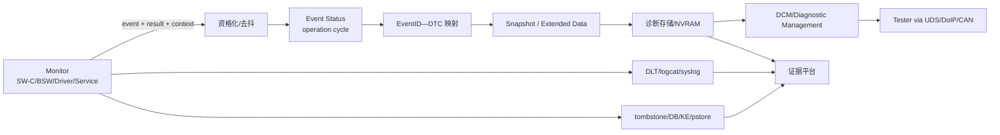
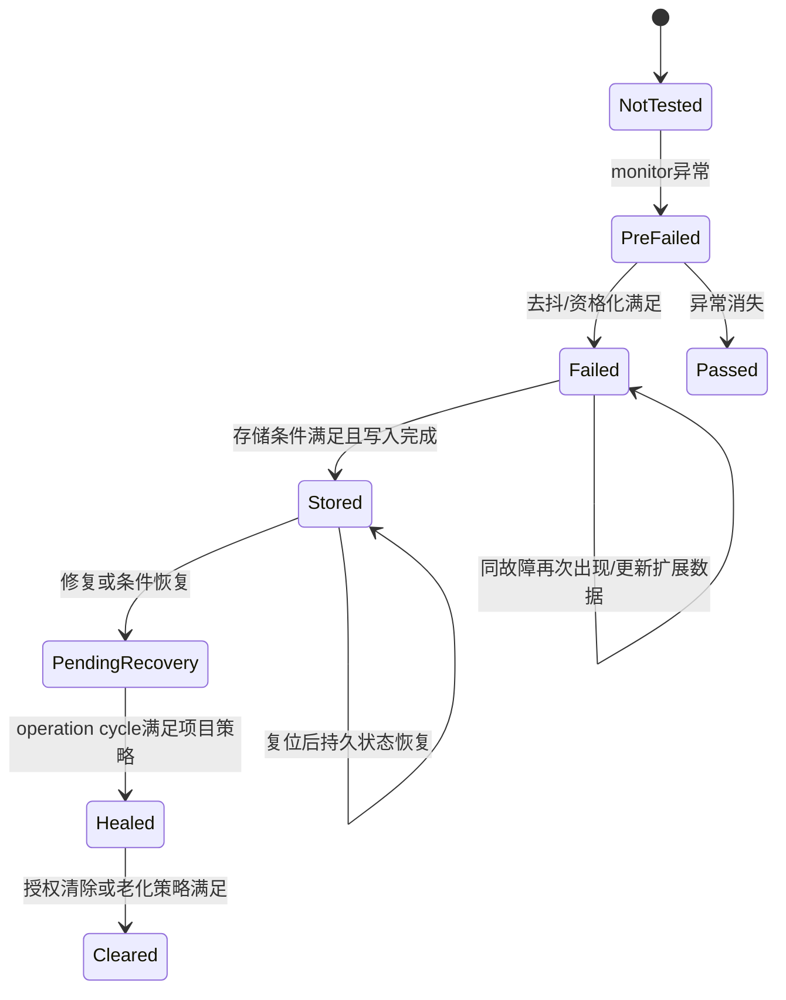

# Day 45 — 诊断架构 I：健康状态、故障码与证据留存

学习日期：2026-10-19，星期一，Asia/Shanghai；Week 15。能力阶段：第二阶段“系统链路与问题分析”。目标深度：从 L2 机制解释进入 L3 证据诊断，能把健康监控、事件资格化、DTC、冻结帧、日志和崩溃转储放进一条可验证的诊断链。总用时约 60 分钟。

执行前已完整扫描仓库全部状态的 Issue；当前没有答卷 Issue、编辑版本、本人 `[补交]` 评论或本聊天新增作答。因此 Day 34—45 均保持待评审，本课不把材料发布记为已经掌握。

## 1. 今日资料、术语与项目边界

官方资料核验日期：2026-10-19。

- [AUTOSAR Diagnostic Event Manager R22-11](https://www.autosar.org/fileadmin/standards/R22-11/CP/AUTOSAR_SWS_DiagnosticEventManager.pdf)：用于事件报告、资格化/去抖、UDS 状态、事件存储、Snapshot Record、Extended Data 和 NVRAM 边界。
- [AUTOSAR Diagnostic Communication Manager R22-11](https://www.autosar.org/fileadmin/standards/R22-11/CP/AUTOSAR_SWS_DiagnosticCommunicationManager.pdf)：用于诊断请求入口、会话、安全条件、正/负响应与 Dem 数据读取边界。
- [AUTOSAR Platform Health Management R22-11](https://www.autosar.org/fileadmin/standards/R22-11/AP/AUTOSAR_SWS_PlatformHealthManagement.pdf)：用于监督状态、健康监控、通知 State Management 与恢复责任边界。
- [AUTOSAR Log and Trace R22-11](https://www.autosar.org/fileadmin/standards/R22-11/AP/AUTOSAR_SWS_LogAndTrace.pdf)：用于日志上下文、严重度、传输和过滤边界；日志不是 DTC 的替代品。
- [Linux ramoops/pstore](https://docs.kernel.org/admin-guide/ramoops.html)：用于理解 Oops/Panic 发生后跨重启保存内核证据的机制和容量限制。
- [AOSP：Debug native Android platform code](https://source.android.com/docs/core/tests/debug)：用于理解 Android native crash 的 tombstone、线程回溯、内存映射与 Build ID。
- 本仓库[第 15 章：统一诊断手册](https://qiantao18817568425-art.github.io/Architecture_Learning-/architecture/15.html)的 15.1、15.4、15.8、15.9，以及[第 08 章：MCU 内部机制](https://qiantao18817568425-art.github.io/Architecture_Learning-/architecture/08.html)的 DTC 生成/存储与诊断工具链，用于对齐现有架构资料。

### 1.1 六个对象不能混为一谈

| 对象 | 定义 | 不能单独证明 |
| --- | --- | --- |
| Health signal | 心跳、checkpoint、资源阈值或自检结果 | 已形成故障或需要复位 |
| Diagnostic event | 监控路径报告的候选故障事实 | 已满足 DTC 存储条件 |
| Event status | 去抖、资格化和 operation cycle 后的状态 | DTC 已持久化且可被 tester 读取 |
| DTC | 对一个或多个诊断事件的标准化故障表达 | 当前故障仍 active、根因已定位 |
| Snapshot/Extended Data | 故障时环境和累计数据 | 数据完整、时钟可比、版本匹配 |
| Log/Dump | 执行路径、错误上下文和崩溃现场 | 已完成诊断状态机和售后闭环 |

当前缺少车型、SoC、硬件阶段、Android/Yocto/MCU/TBox 版本、诊断字典、EventID—DTC 映射、operation cycle、去抖、storage/enable condition、NVRAM 布局、UDS/DoIP 配置、权限策略和实机样本。下文编号、阈值、次数、错误码、SID/DID/NRC 和保留周期全部待项目确认。

本次从 `F:/座舱日志分析/交付物/T12T诊断技能家族-优化版/` 重新读取全部 21 项技能入口，并读取平台架构、证据方法、日志时间、稳定性复位、DB/KE、MCU 和 TPM 分责参考手册。深入使用通用三入口、稳定性复位、DB/KE 取证、MCU 和 TPM 分责专项。

## 2. 一小时主线

| 时间 | 学习任务 | 输出 |
| --- | --- | --- |
| 0—10 分钟 | 回顾 5 题 | 分清监控、事件、DTC、日志和业务恢复 |
| 10—30 分钟 | 两个核心概念 | 诊断事件状态机、证据合同 |
| 30—50 分钟 | 工程案例 | 正向诊断链、最早断点、责任与恢复 |
| 50—60 分钟 | 可复用产物 | 《健康事件—DTC 证据合同 V1》 |

回顾题：

1. 看门狗 heartbeat timeout 与 DTC 有什么关系，为什么不能直接画等号？
2. “事件报告接口返回成功”“事件 qualified”“DTC stored”“tester 读到 DTC”分别是哪一层完成？
3. 为什么清除 DTC 不能证明故障修复？
4. 复位前、复位中、复位后各应保留哪些身份和时间字段？
5. 普通日志、冻结帧、tombstone、pstore 各自覆盖什么证据，容量和覆盖风险如何管理？

## 3. 核心概念一：诊断链是状态机，不是一次报错

### 3.1 正常职责链

| 层级 | Owner | 输入 | 输出 | 关键观测 |
| --- | --- | --- | --- | --- |
| 监控 | 功能/驱动/服务 Owner | 原始信号、checkpoint、错误返回 | passed/failed/pre-failed 等项目状态 | source、对象、采样时刻、阈值版本 |
| 资格化 | Dem 或诊断策略 | 连续监控结果、条件、cycle | qualified event status | 去抖计数、enable/storage condition、状态转换原因 |
| 映射与存储 | Dem/诊断存储 | EventID、DTC 配置、环境数据 | DTC 状态、快照、扩展数据 | DTC、status byte、occurrence、first/most recent fail |
| 诊断服务 | DCM/DM/网关 | tester request、会话、安全、路由 | 正/负响应、数据记录 | tester、SID、session、security、NRC、目标 ECU |
| 运维分析 | 平台/问题 Owner | DTC、log、dump、trace、版本 | 假设、反证、修复与验证 | bootId、generation、buildId、时钟映射、证据哈希 |

### 3.2 状态机与复位边界

这张图是教学抽象，不替代 AUTOSAR 的完整状态位和项目配置。架构设计必须明确：

- operation cycle 由谁开启/结束，掉电、STR、Guest 重建和 MCU reset 是否属于同一 cycle；
- 去抖是在 Monitor 还是 Dem，计数跨不跨复位；
- enable condition 与 storage condition 分别控制“是否评价”和“是否存储”；
- EventID、DTC、Snapshot Record、Extended Data 的映射和版本；
- NVRAM 写入时机、掉电原子性、空间满和淘汰规则；
- active、pending、confirmed、healed、aged、cleared 在项目中的准确语义。

## 4. 核心概念二：证据合同必须跨域、跨复位且可关联

一个可用的诊断事件至少要回答“哪个对象、哪一代、什么状态、何时、依据什么、保存到哪里”。建议最小字段：

| 字段组 | 字段 | 用途 |
| --- | --- | --- |
| 身份 | vehicle/config/build、ECU/VM/process、component、EventID、DTC | 防止错版本、错对象和错配置 |
| 代际 | powerCycle、bootId、VM generation、process incarnation、incidentId | 隔离复位前后的旧事件 |
| 时间 | source monotonic、wall/UTC、sync status、uncertainty、anchor | 跨 Android/Yocto/MCU/TBox 关联 |
| 状态 | monitor result、debounce、event status、DTC status、operation cycle | 解释状态如何演进 |
| 环境 | 电源模式、网络/资源状态、关键输入、最近成功里程碑 | 形成可区分的冻结帧 |
| 证据 | log cursor、dump/tombstone/pstore ID、hash、retention | 找到原始现场并防止覆盖 |
| 动作 | recovery request、ACK、actual reset scope、result、business validation | 区分恢复动作和最终恢复 |

### ACK 与业务完成

| 事件 | 最多证明 |
| --- | --- |
| `ReportErrorStatus()` 或等价接口返回 | 报告调用按接口语义被接收/处理 |
| 监控进入 Failed | 当前监控与资格化达到故障态 |
| DTC memory entry created | 诊断记录进入指定事件内存 |
| NvM write completed | 该数据块按存储合同写入；仍需核对掉电保持与版本 |
| UDS/DoIP 正响应 | 本次诊断服务请求成功完成到规定层级 |
| tester 读到 DTC 与快照 | 外部读取链可见一致记录 |
| 修复后状态恢复、故障不再激活 | 当前运行满足业务与诊断恢复判据 |
| 清除请求成功 | 记录按授权策略被清除，不代表缺陷已修复 |

超时与复位规则至少包含：报告队列满时是否丢弃或降级；存储写入超时的重试上限；复位前证据 flush 的预算；旧 boot/generation 事件是否允许更新新代状态；DTC 清除、老化和业务恢复各自独立；重复 incident 如何去重而不覆盖首错。

## 5. 完整故障分析：有异常日志但售后读不到 DTC

以下是教学构造案例，用来演示完整分析方法；其中事实和结论不代表当前车辆。

### 5.1 现象与构造证据

- 冷启动后 Camera 服务三次记录 serializer lock lost，HMI 一度降级提示；约 8 秒后画面自行恢复。
- 同一次运行中，售后 tester 通过 DoIP 读取目标 ECU，未见对应 DTC。
- 重新上电后普通日志已轮转，仍能从持久区取到一次 reset reason，但没有目标事件冻结帧。

| 证据 | 构造事实 | 证据边界 |
| --- | --- | --- |
| E1 | Driver 记录三次 lock lost，带 bootId=b17、monotonic、port=2 | 直接证明驱动观察到异常，不证明诊断事件 qualified |
| E2 | Camera service 记录 degrade enter/exit | 证明业务降级发生，不证明 DTC 存储 |
| E3 | Monitor 调用 event report 返回 OK | 证明报告接口局部完成，不证明 Dem 状态变化 |
| E4 | Dem trace 显示 storage condition=false | 证明当前条件阻止存储；条件来源和配置原因待查 |
| E5 | 没有 debounce counter、operation cycle 与 status transition 记录 | 这是证据缺口，不能写成“没有资格化” |
| E6 | tester routing activation 与诊断会话成功，其他 DTC 可读 | 降低 DoIP 公共链路故障优先级，不证明目标记录存在 |
| E7 | 目标 EventID—DTC 映射来自另一配置版本 | 构成版本不一致风险，仍需核对现车加载配置 |
| E8 | pstore 只有 reset reason，没有本事件冻结帧 | pstore 与 Dem 存储职责不同，不能互相替代 |

### 5.2 正向链、最早断点与竞争假设

1. 最后已证实成功：Monitor 的事件报告接口在 b17 中返回 OK。
2. 下一预期里程碑：当前配置下 Dem 接收同一 EventID，并按 enable/storage、去抖和 cycle 产生可解释的状态转换。
3. 当前最早可证实的异常边界：E4 表明存储条件为 false；但 E5 使“资格化是否完成”仍未知。
4. 不能下的结论：不能只因 E4 就断言 storage condition 配置错误，也不能因 tester 读不到 DTC 就归责 DoIP/DCM。
5. 竞争假设：条件策略按设计抑制瞬态故障；现车配置版本或映射错误；Monitor 与 Dem 的 EventID 不一致；资格化尚未满足；存储队列/持久化失败但缺日志。
6. 区分实验：固定同一镜像和诊断配置，记录 Monitor→Dem 输入、条件值来源、去抖计数、status byte、memory entry 与 tester read；每次只改变一个条件或故障持续时间。
7. 初步责任：首轮由诊断配置/Dem Owner 牵头，Camera/Driver 提供事件产生证据，平台存储提供写入证据，DCM/DoIP 提供读取反证，TPM 维护同一版本和时间线。

### 5.3 恢复与关闭

- 现场保护：先保存 b17 原始日志、Dem 状态、诊断配置哈希、tester trace 和环境，再重启或清除。
- 临时措施：若业务已恢复但证据不足，保留降级统计和采集增强；不得为了“产生 DTC”随意放宽量产门限。
- 修复候选：依据区分实验决定是修正条件来源、配置映射、去抖设计、存储路径还是观测能力，不能预先指定。
- 验证：正常启动不误报码；瞬态、持续、间歇故障各符合策略；掉电/Guest reset/服务重启后状态一致；tester 读到正确 DTC 和快照；清除受会话与权限约束；修复后业务和诊断状态按 operation cycle 收敛。

### 5.4 TPM 可对研发与管理层说明

当前证据证明 Camera 业务经历过短时降级，也证明事件报告接口返回成功；尚未证明事件完成资格化和持久存储。外部诊断链能读取其他 DTC，因此首轮应集中核对目标 EventID、条件、去抖、配置版本和存储状态。责任将按 Monitor→Dem→Memory→DCM/DoIP 的最早可证实断点收敛，修复关闭必须同时验证业务恢复、DTC 状态、冻结帧和复位后的持久一致性。

## 6. 可执行测试矩阵

| 用例 | 注入/步骤 | 关键观测 | 通过标准 | 状态 |
| --- | --- | --- | --- | --- |
| 正常路径 | 正常启动并完成一次 operation cycle | event/status/memory/tester | 无误报码，状态可解释 | 待执行 |
| 瞬态异常 | 小于项目去抖门限 | pre-failed、counter、业务影响 | 按策略不误确认，证据可追踪 | 待执行 |
| 持续异常 | 超过资格化门限 | qualified、DTC、snapshot | 目标记录完整且可读取 | 待执行 |
| 间歇异常 | fail/pass 交替 | debounce 与 occurrence | 状态不抖动，计数规则一致 | 待执行 |
| 条件门控 | 切换 enable/storage condition | 条件来源与转换原因 | 评价和存储行为符合配置 | 待执行 |
| 掉电边界 | 存储前/中/后受控断电 | NvM 状态、记录完整性 | 无半条记录和错误代际 | 待执行 |
| Guest/服务重启 | 只重建 Consumer 或诊断服务 | boot/generation、恢复读取 | 旧事件不污染，新状态可重建 | 待执行 |
| MCU/SoC reset | 分别触发授权复位 | reset reason、pstore、DTC | 复位原因和事件可关联 | 待执行 |
| 存储满/日志风暴 | 受控填充容量 | 淘汰、drop、rate limit | 首错与关键快照不被冲掉 | 待执行 |
| tester 异常 | 会话不满足、未解锁、链路中断 | SID/session/security/NRC | 拒绝可解释，不改写 DTC | 待执行 |
| 清除与复现 | 授权清除后重新注入 | clear audit、新 incident | 清除不冒充修复，新事件可记录 | 待执行 |
| 隐私与权限 | 读取受限数据 | ACL、脱敏、审计 | 未授权读取被拒绝 | 待执行 |

不要在量产车或未授权设备上执行故障注入、清除 DTC、改配置、复位或存储填充。所有门限、循环次数和通过标准以项目合同为准。

## 7. 今日独立练习

新题不附参考答案、示范作答或预设根因。

构造场景：车辆发生一次“音频功放无输出”，Android Audio service、Yocto 音频服务、DSP、MCU 和 Amp 各有部分日志；重启音频服务后恢复，tester 读取到一个历史 DTC，但时间与本次现象尚未关联。

请独立完成：

1. 画出 Health signal→event→资格化→DTC→快照→存储→tester 的状态与时序图；
2. 将 Android、Yocto、DSP、MCU、Amp 的控制、数据、状态和电源路径分开；
3. 至少提出三个竞争假设，填写支持、反证、缺口和单变量实验；
4. 指出最早可证实断点，并说明当前不能归责的域；
5. 定义事件报告 ACK、DTC stored、tester read 和“声音恢复”的不同完成语义；
6. 设计 timeout、复位、旧消息、重复 incident、日志覆盖和存储满策略；
7. 给出从现场保护到修复关闭的测试矩阵与 TPM 分责表。

## 8. 可复用产物：《健康事件—DTC 证据合同 V1》

至少包含：

1. 事件目录：对象、Monitor、EventID、DTC、严重度、业务影响；
2. 状态合同：条件、去抖、operation cycle、确认/恢复/老化/清除；
3. 快照合同：触发时机、字段、来源、时间、代际、隐私；
4. 存储合同：介质、写入 ACK、容量、淘汰、掉电原子性、保留周期；
5. 读取合同：DCM/DM、UDS/DoIP、会话、安全、正/负响应；
6. 证据合同：日志、dump、pstore、tombstone、配置哈希和关联 ID；
7. 恢复合同：动作、影响半径、预算、失败出口和业务验收；
8. 测试与分责：正常、边界、异常、复位、共享资源、隐私和回归。

## 9. 提交说明

本课编号 **day-45**。请提交 5 道回顾题、诊断状态图、音频功放场景分析、竞争假设、证据账本、测试矩阵、TPM 分责表和《健康事件—DTC 证据合同 V1》。个人反思由你本人填写：哪一个“成功”最容易被我误当成 DTC 或业务闭环？哪项证据最容易在复位后丢失？

使用页面末尾“上传／提交答卷”，或进入[答卷中心](https://qiantao18817568425-art.github.io/Architecture_Learning-/answers/index.html)。答卷、附件与批改公开，请只提交可公开且已脱敏的学习材料。编辑原答卷或本人以 `[补交]` 开头评论会生成新版本并重新评审。

## 附录：21 项 T12T 技能覆盖检查

| 技能 | 本次判断 |
| --- | --- |
| t12t-cockpit-diagnosis | 适用，深入：现象、版本、材料、时间与运行域入口 |
| t12t-log-analysis | 适用，深入：证据分级、三槽、跨域时间与最早断点 |
| t12t-platform-architecture | 适用，深入：Android、Yocto、MCU、TBox、Hypervisor 边界和四路路径 |
| t12t-display-black-freeze | 条件适用：显示故障可生成事件，本课没有显示链实机证据 |
| t12t-touch-input | 条件适用：触摸自检与错误事件可接入，当前无触摸现象 |
| t12t-avm-camera-stream | 适用：教学案例涉及 Camera 事件；器件、端口和 ID 均待确认 |
| t12t-power-sleep-str | 适用：operation cycle、掉电存储和复位边界需对齐电源状态 |
| t12t-audio-path | 适用：独立练习涉及跨 Android/Yocto/DSP/MCU/Amp 诊断链 |
| t12t-stability-crash-reset | 适用，深入：复位层级、reset reason、连续性和恢复半径 |
| t12t-performance-jank | 条件适用：资源阈值可进入健康监控，当前无性能实测 |
| t12t-ethernet-sgmii | 条件适用：DoIP 与网络证据需分层，当前无 PHY/PCS 故障 |
| t12t-wireless-phone-link | 本课无无线/手机互联现象，专项不展开 |
| t12t-cross-domain-msg | 适用：事件、DTC、tester 响应和代际关联跨域 |
| t12t-boot-hmi | 适用：启动、operation cycle 和证据恢复顺序需观测 |
| t12t-log-storm | 适用：容量、轮转、rate limit 与首错留存设计 |
| t12t-usb-typec-storage | 条件适用：诊断存储介质可能相关，当前无 USB 故障 |
| t12t-virtualization-tee | 适用：VM generation、持久存储与安全访问边界 |
| t12t-db-ke-forensics | 适用，深入：DB/KE/tombstone/pstore 分类、版本和原始证据保全 |
| t12t-mcu | 适用，深入：MCU Event/DTC、operation cycle、reset reason 与现车协议核验 |
| t12t-tpm-triage | 适用，深入：Monitor、Dem、存储、DCM/DoIP、验证责任分离 |
| t12t-tpm-5y8d | 暂不展开：独立练习没有确认根因与逃逸原因，不强行生成 5Y/8D |

关键证据缺口：现车版本和拓扑、诊断字典、EventID—DTC 映射、operation cycle、去抖/门控、DTC memory、NVRAM 策略、UDS/DoIP 会话与安全、跨域时钟、隐私分级、真实日志/dump、故障注入权限与关闭样本。
