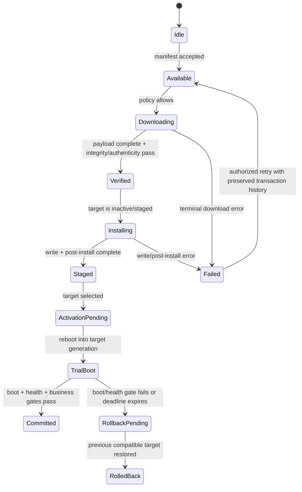

# Day 47 — OTA / 回滚 I：版本合同、安装状态机与失败恢复

计划学习日期：2026-10-21，星期三，Asia/Shanghai；2026-10-23 补充登记并首次发布。Week 15。能力阶段：第二阶段“系统链路与问题分析”。目标深度：L3，能把 OTA 从“下载一个包”拆成版本合同、写入、激活、首启确认、提交或回退的一条可验证状态机。总用时约 60 分钟。

执行前已扫描仓库全部状态的答卷 Issue 和评论；没有发现授权学习者的新答卷、补交或附件。因此 Day 34—47 仍为待真实作答评审，本课发布不代表已经掌握。

## 1. 资料与项目边界

官方资料核验日期：2026-10-23。

- [AOSP OTA updates](https://source.android.com/docs/core/ota)：OTA 包、A/B 与 Virtual A/B 的通用入口。
- [AOSP A/B system updates](https://source.android.com/docs/core/ota/ab)：非活动 Slot 写入、激活、首启确认和失败回退。
- [AOSP bootloader OTA requirements](https://source.android.com/docs/core/architecture/bootloader/updating)：Boot Control、Slot 状态和 retry 的职责边界。
- [AUTOSAR AP Update and Configuration Management R22-11](https://www.autosar.org/fileadmin/standards/R22-11/AP/AUTOSAR_SWS_UpdateAndConfigurationManagement.pdf)：Software Package、处理、激活、回滚与版本记录的通用职责。
- 本知识库 [MT8676 Android OTA 手册来源页](https://qiantao18817568425-art.github.io/Architecture_Learning-/architecture/source-SRC0164.html)、[Hypervisor OTA 手册来源页](https://qiantao18817568425-art.github.io/Architecture_Learning-/architecture/source-SRC0219.html)和[第 14 章生命周期](https://qiantao18817568425-art.github.io/Architecture_Learning-/architecture/14.html)，仅作为对应版本的来源材料，不自动代表当前车型配置。

当前缺少车型、SoC、硬件阶段、分区表、A/B 或 Virtual A/B 方案、Boot Control 实现、Hypervisor/Yocto/Android/MCU/TBox 升级职责、包格式、签名链、版本兼容矩阵、掉电预算和真实升级日志。Slot 名、重试次数、时限、错误码和提交条件全部待项目确认。

## 2. 一小时主线

| 时间 | 学习任务 | 输出 |
| --- | --- | --- |
| 0—10 分钟 | 回顾 5 题 | 区分下载、安装、激活、首启和业务验收 |
| 10—30 分钟 | 两个核心概念 | 版本合同；可恢复安装状态机 |
| 30—50 分钟 | 工程案例 | OTA 显示成功但车辆回到旧版本 |
| 50—60 分钟 | 可复用产物 | 《单域 OTA 安装与回滚合同 V1》 |

回顾题：

1. 包下载完成、签名校验通过、目标 Slot 写完、Slot 被设为 active、首次启动成功分别证明什么？
2. 为什么“系统能启动”还不能直接标记升级成功？
3. 差分包失败后改用全量包，原事务的版本、证据和 deadline 应怎样保留？
4. 复位或掉电发生在写入、激活、首启确认三个阶段时，恢复策略有什么不同？
5. 为什么回到旧 Slot 只能证明回退机制生效，不能单独证明新镜像失败的根因？

## 3. 核心概念一：版本合同先于安装动作

OTA 版本合同至少要同时约束“给谁、从什么版本、升级到什么版本、依赖谁、如何验证、失败后回哪里”。

| 合同组 | 最小字段 | 评审目的 |
| --- | --- | --- |
| 目标身份 | vehicle/config、ECU、VM、partition/SoftwareCluster、hardware variant | 防止错车、错域、错分区 |
| 基线 | current version、source hash、slot、bootId、compatibility level | 确认差分与依赖起点 |
| 目标 | target version、payload hash、签名、manifest、rollback index | 确认完整性、真实性和降级边界 |
| 依赖 | bootloader/vendor/system、Hypervisor/Guest、MCU/TBox、接口/数据版本 | 防止单域成功但整车不兼容 |
| 激活 | reboot scope、activation order、health gate、deadline | 说明何时切换与何时提交 |
| 回退 | fallback target、retry、不可回退条件、数据迁移策略 | 保证失败出口可执行 |
| 证据 | campaignId、packageId、transactionId、阶段、错误码、日志/哈希 | 跨复位重建唯一事实 |

控制流是检查策略、授权、下载、校验、安装、激活、提交/回滚；数据流是 manifest、payload、签名、分区块和迁移数据；状态流是包、Slot、机器和业务健康状态；时间流需要跨重启保留 campaignId、transactionId、boot counter 与单调阶段序号。

## 4. 核心概念二：安装成功是一条状态机



这是一张架构教学状态机，不替代项目实现。每个转移都要定义：权威状态保存在哪里、写入是否原子、ACK 到哪一层、超时由谁判定、复位后从何处继续、旧回调如何拒绝、重试是否幂等、最终如何验收。

### 4.1 ACK 与业务完成

| 里程碑 | 最多证明 |
| --- | --- |
| manifest accepted | 元数据通过当前入口校验 |
| payload downloaded | 指定字节已到本地；不证明签名或目标适配 |
| verification passed | 包按当前信任与完整性规则通过 |
| write completed | 目标介质写入步骤完成；不证明可启动 |
| post-install returned success | 规定的安装后动作完成到接口响应点 |
| set active ACK | 下次启动目标已按接口更新；不证明能完成启动 |
| kernel/userspace ready | 新版本运行到对应里程碑；不证明所有业务兼容 |
| health gate passed | 规定健康条件满足；仍需业务与整车依赖验收 |
| commit/mark successful | 当前目标被接受为权威版本 |
| rollback completed | 旧版本恢复到定义层级；不证明新版本根因 |

## 5. 正常时序与异常处理

```mermaid
sequenceDiagram
    participant O as OTA Orchestrator
    participant V as Version/Policy
    participant I as Installer/update engine
    participant B as Boot Control
    participant H as Health & Business Gate
    O->>V: Check target, baseline, dependency, authorization
    V-->>O: Contract accepted
    O->>I: Apply payload(campaignId, packageId, target)
    I->>I: Verify then write inactive/staged target
    I-->>O: Staged result + evidence
    O->>B: Activate target generation
    B-->>O: Activation ACK
    Note over O,B: reboot; preserve authoritative transaction state
    B->>H: Boot target generation
    H-->>O: boot/health/business results
    alt all gates pass
        O->>B: Commit / mark successful
    else gate fails or deadline expires
        O->>B: Roll back to compatible target
        B-->>O: Rollback result
        O->>H: Validate restored business
    end
```

超时不应无限重置原 deadline。复位后先读取持久状态、当前运行版本、当前 Slot/generation 和已完成阶段，再决定 resume、retry、rollback 或 manual recovery。旧 campaign、旧 Slot 或旧 generation 的完成回调不得覆盖新事务。终态不明时标记 `unknown`，通过 readback 收敛，不能直接重做有副作用步骤。

## 6. 完整故障分析：工具显示升级成功，但下次启动仍是旧版本

以下为教学构造案例，不代表当前车辆。

### 6.1 构造证据

| 证据 | 构造事实 | 证据边界 |
| --- | --- | --- |
| E1 | 下载端记录 payload 100%，hash 与 manifest 一致 | 证明下载与完整性，不证明签名链和安装 |
| E2 | installer 返回 `staged`，目标为非活动 Slot | 证明安装阶段到达 staged 接口点 |
| E3 | Boot Control 记录 set-active ACK | 证明目标选择请求完成，不证明首启成功 |
| E4 | 新 Slot 出现一次 boot attempt，未出现 mark-successful | 证明进入 trial boot，提交条件未闭环 |
| E5 | bootloader 随后选择旧 Slot | 证明发生回退；回退触发原因仍需 boot/health 证据 |
| E6 | OTA 应用把 set-active ACK 显示为“升级成功” | 证明完成语义设计错误，未证明新镜像本身有缺陷 |
| E7 | 缺少新 Slot 的 kernel、userspace 与业务健康里程碑 | 关键缺口，不能判断失败发生在哪层 |

### 6.2 最早断点与竞争假设

最后已证实成功是目标 Slot 激活请求完成；下一预期是目标 Slot 在新 boot generation 中完成启动、健康和业务门禁并被提交。当前最早可证实边界是 `trial boot → health/commit`，而不是下载或写入。

竞争假设至少包括：新 Slot 启动失败；系统启动但健康门禁超时；业务门禁误判；版本依赖不匹配；mark-successful 调用未发生或未持久化；启动日志缺失导致实际成功被误判。区分实验要在同一包与同一基线下，贯通 Slot metadata、boot attempt、boot reason、kernel/userspace milestone、health gate、commit 调用和 bootloader 下一次选择。

恢复时保留失败 Slot 与证据，按项目策略回到已知兼容版本；不得先清日志、覆盖目标 Slot 或反复重启。关闭需要验证正常升级、失败回退、掉电中断、重试幂等、数据兼容和用户业务恢复。

## 7. 可执行验证矩阵

| 用例 | 注入/步骤 | 关键观测 | 通过标准 | 状态 |
| --- | --- | --- | --- | --- |
| 正常全量升级 | 合法基线安装完整包 | 版本、hash、阶段、Slot、health | 提交后版本与业务一致 | 待执行 |
| 差分基线不匹配 | 使用错误 source version | baseline check、错误码 | 写入前拒绝且原因明确 | 待执行 |
| 下载中断 | 网络断开后恢复 | offset、hash、retry id | 可恢复且不重复提交 | 待执行 |
| 写入掉电 | 安装中受控断电 | journal、目标 Slot、readback | 不破坏当前可启动版本 | 待执行 |
| post-install 失败 | 受控返回失败 | 阶段、错误码、active Slot | 不激活不完整目标 | 待执行 |
| 激活后首启失败 | 让健康门禁失败 | boot attempt、rollback reason | 自动回到兼容版本 | 待执行 |
| 健康 ACK 迟到 | 超过总 deadline 返回 | campaign/generation | 旧 ACK 不提交当前目标 | 待执行 |
| 服务/VM 重启 | 安装器进程或域重建 | 持久状态、resume point | 从权威阶段恢复 | 待执行 |
| 重复命令 | 重放同一 transactionId | 幂等、写入次数、终态 | 无双执行与状态回退 | 待执行 |
| 存储不足 | 边界空间与快照空间 | 预检、清理、错误码 | 写入前安全失败 | 待执行 |
| 回滚后业务验证 | 检查关键用户链路 | 版本、配置、数据、功能 | 旧版本与数据仍兼容 | 待执行 |

不要在量产车或未授权设备上执行刷写、切 Slot、回滚索引变更、掉电注入或强制复位。所有操作只在项目授权与可恢复环境中进行。

## 8. 今日独立练习

新题不附参考答案、示范作答或预设根因。

场景：一次 Android OTA 在后台下载和安装后提示“升级完成，请重启”。车辆重启后启动时间变长，最终进入旧版本；OTA 应用只保留下载成功和 set-active 成功两条记录。

请独立完成：

1. 画出下载、校验、写入、激活、trial boot、health gate、commit/rollback 状态图；
2. 列出控制、数据、状态、电源/时间四条路径；
3. 区分每个 ACK 与最终业务完成；
4. 提出至少四个竞争假设及反证、缺口和单变量实验；
5. 定义掉电、超时、服务重启、旧回调和重复命令处理；
6. 给出证据账本、测试矩阵和 TPM 分责；
7. 产出《单域 OTA 安装与回滚合同 V1》。

## 9. 提交说明

本课编号 **day-47**。使用页面末尾“上传／提交答卷”或进入[答卷中心](https://qiantao18817568425-art.github.io/Architecture_Learning-/answers/index.html)。请提交回顾题、状态图、构造案例、竞争假设、证据账本、验证矩阵、TPM 分责和合同。个人反思由你本人填写：我最容易把哪个局部成功误判为升级已经完成？

## 附录：21 项 T12T 技能覆盖检查

| 技能 | 本次判断 |
| --- | --- |
| t12t-cockpit-diagnosis | 适用，深入：版本、运行域、状态机、证据与责任入口 |
| t12t-log-analysis | 适用，深入：跨重启时间线、最早断点、证据与缺口 |
| t12t-platform-architecture | 适用，深入：Bootloader、Hypervisor、Yocto、Android、MCU/TBox 边界 |
| t12t-display-black-freeze | 条件适用：首启黑屏可能是门禁失败；当前无显示实机证据 |
| t12t-touch-input | 材料不足：升级后需回归，当前无触摸现象 |
| t12t-avm-camera-stream | 条件适用：升级后 Camera 兼容性需回归，当前无视频流证据 |
| t12t-power-sleep-str | 适用：电源条件、重启、掉电中断和恢复预算 |
| t12t-audio-path | 条件适用：版本切换后音频链回归，当前无音频故障 |
| t12t-stability-crash-reset | 适用，深入：boot attempt、reset reason、回退和代际连续性 |
| t12t-performance-jank | 条件适用：安装与首启性能门禁，当前无实测数据 |
| t12t-ethernet-sgmii | 条件适用：下载承载可分层诊断，当前无 PHY/PCS 故障 |
| t12t-wireless-phone-link | 条件适用：下载网络可能相关，当前无无线现象 |
| t12t-cross-domain-msg | 适用：orchestrator、installer、Boot Control 与健康门禁的事务关联 |
| t12t-boot-hmi | 适用，深入：trial boot、首帧/业务 ready 与提交门禁 |
| t12t-log-storm | 适用：升级日志留存、轮转、首错和容量保护 |
| t12t-usb-typec-storage | 条件适用：离线升级介质和存储失败，当前无 USB 证据 |
| t12t-virtualization-tee | 适用，深入：VM/Hypervisor 更新边界、可信状态与恢复 |
| t12t-db-ke-forensics | 条件适用：首启崩溃需关联异常包，当前无 DB/KE |
| t12t-mcu | 适用：电源协调、版本依赖与 MCU 复位/健康状态 |
| t12t-tpm-triage | 适用，深入：包、安装、启动、健康、业务和验证责任分离 |
| t12t-tpm-5y8d | 暂不展开：教学案例没有确认根因和逃逸原因 |

关键证据缺口：现车版本与分区、包和签名链、A/B/Virtual A/B 方案、Boot Control/Slot metadata、跨域依赖、健康与业务门禁、掉电恢复、回滚策略和真实升级样本。
