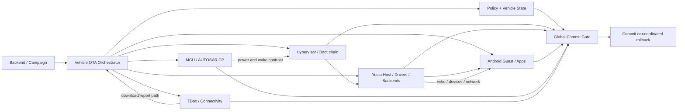
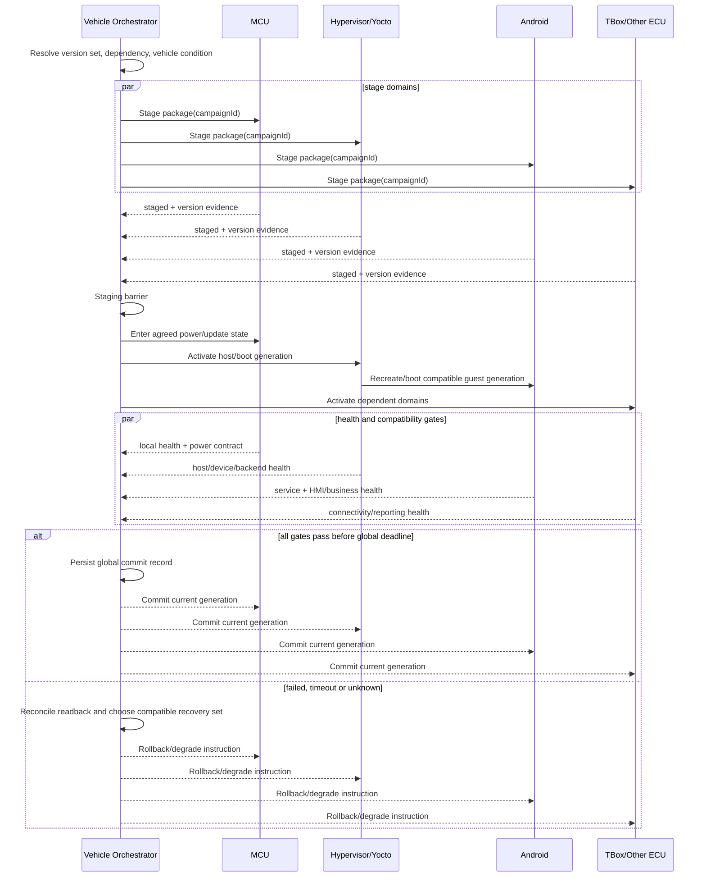

# Day 48 — OTA / 回滚 II：跨域编排、安全提交与整车验证

计划学习日期：2026-10-22，星期四，Asia/Shanghai；2026-10-23 补充登记并首次发布。Week 15。能力阶段：第二阶段“系统链路与问题分析”。目标深度：L3，能设计 Hypervisor、Yocto、Android、MCU、TBox 或外部 ECU 的升级依赖、提交屏障、安全降级边界和整车关闭标准。总用时约 60 分钟。

执行前答卷扫描没有发现新的授权答卷、补交或附件。本课不把发布记为学习完成，Day 34—48 继续等待真实作答评审。

## 1. 资料与项目边界

官方资料核验日期：2026-10-23。

- [AUTOSAR Adaptive Platform：Vehicle Update and Configuration Management](https://www.autosar.org/standards/adaptive-platform)：V-UCM 协调整车 campaign、依赖、安全条件、软件包分发、历史和失败恢复。
- [AUTOSAR AP UCM R22-11](https://www.autosar.org/fileadmin/standards/R22-11/AP/AUTOSAR_SWS_UpdateAndConfigurationManagement.pdf)：单个 Adaptive Platform 的安全安装、激活、回滚和记录职责。
- [AOSP Android Verified Boot](https://source.android.com/docs/security/features/verifiedboot/avb)：信任根、签名验证和 rollback protection 的通用机制。
- [AOSP Verified Boot flow](https://source.android.com/docs/security/features/verifiedboot/boot-flow)：A/B 设备在更新 rollback protection metadata 前先把新 Slot 标为 successful 的边界。
- 本知识库 [MT8676 Hypervisor OTA 来源页](https://qiantao18817568425-art.github.io/Architecture_Learning-/architecture/source-SRC0219.html)、[Yocto OTA 来源页](https://qiantao18817568425-art.github.io/Architecture_Learning-/architecture/source-SRC0263.html)和[安全启动来源页](https://qiantao18817568425-art.github.io/Architecture_Learning-/architecture/source-SRC0071.html)用于来源追溯，实际车型与版本仍待核对。

当前没有现车 ECU 清单、升级拓扑、UCM/V-UCM 实现、车辆安全状态、证书/密钥和 rollback index 配置、跨域版本兼容矩阵、数据迁移策略或实车 campaign。下文所有顺序、门限、时间和 Owner 都是架构合同模板。

## 2. 一小时主线

| 时间 | 学习任务 | 输出 |
| --- | --- | --- |
| 0—10 分钟 | 回顾 5 题 | 分清单域提交、整车提交和安全不可回退 |
| 10—30 分钟 | 两个核心概念 | 依赖图与提交屏障；安全回退边界 |
| 30—50 分钟 | 工程案例 | Android 已新版本但 MCU 仍旧版本 |
| 50—60 分钟 | 可复用产物 | 《整车 OTA Campaign 与提交屏障合同 V1》 |

回顾题：

1. 为什么每个 ECU 都返回安装成功，整车 campaign 仍可能失败？
2. 依赖图、安装顺序、激活顺序和回滚顺序为什么不能只用一张线性表表示？
3. rollback protection 与业务回滚是什么关系，为什么安全计数器不能提前提交？
4. 一个域首启健康但跨域协议不兼容，哪个完成条件尚未满足？
5. 断电后 campaign 状态为 unknown 时，为什么不能直接重放所有安装和激活动作？

## 3. 核心概念一：跨域升级是依赖图上的事务

依赖边至少说明：接口/数据版本、启动依赖、共享硬件、供电和唤醒、更新承载、诊断和回滚能力。安装可以并行，激活可能必须分批；提交必须等所有规定门禁对同一 campaign generation 给出权威结果。

| 状态 | 含义 | 不可替代的证据 |
| --- | --- | --- |
| Prepared | 所需包、空间、权限、车辆条件和回滚目标已确认 | manifest、依赖解算、车辆状态快照 |
| Staged | 各目标完成写入/处理但尚未成为权威版本 | 每域 staged result 与版本 readback |
| Activation in progress | 按依赖进入新版本 | boot/generation、重启范围、在途事务 |
| Locally healthy | 单域健康检查通过 | 本域启动、资源、服务和数据 |
| Cross-domain compatible | 关键接口、数据和状态协同通过 | 双端版本、握手、业务序列与反证 |
| Globally committed | campaign 的全部门禁通过并持久提交 | 全局 commit record 与各域 readback |
| Rolled back / degraded | 回到兼容集合或进入明确降级 | 版本集合、用户功能、诊断和审计 |

## 4. 核心概念二：安全提交与业务回滚必须协调

Verified Boot 负责验证启动链上的完整性和真实性；rollback protection 防止启动低于安全版本下限的镜像。业务层希望在新版本失败时回到旧版本，但旧版本只有在安全策略允许、数据格式仍兼容且依赖集合完整时才是有效回退目标。

因此设计顺序通常是：验证新镜像 → trial activation → 本地与跨域健康门禁 → mark successful / 全局提交 → 在正确时点更新不可逆安全元数据。具体顺序必须由当前 Bootloader、TEE/安全存储和项目安全设计确认。过早更新不可逆 rollback index 可能让旧版本失去启动资格；过晚或不更新又可能留下安全降级窗口。

### 4.1 四种“成功”

| 成功 | 含义 |
| --- | --- |
| 包成功 | 包身份、完整性、真实性和适配规则满足 |
| 单域安装成功 | 某 ECU/VM 完成 staged/installed 接口合同 |
| 单域运行成功 | 目标版本启动并通过本地健康门禁 |
| 整车 campaign 成功 | 所有依赖域对同一版本集合完成业务、诊断、安全和提交 |

安全启动通过不等于接口兼容；单域业务可用不等于整车可提交；回滚动作完成也不等于车辆恢复到安全且兼容的版本集合。

## 5. 跨域提交时序

每条消息携带 campaignId、target set、domain generation、transactionId、phase、deadline 和幂等键。复位后域内 ACK 只有在版本 readback、generation 和阶段一致时才有效。旧 campaign 的迟到 `healthy` 不得推进新 campaign；全局超时不能因某个域重试而无限延长。

## 6. 完整故障分析：Android 已升级，但 MCU 仍是旧版本

以下为教学构造案例，不代表当前车辆。

### 6.1 构造证据

| 证据 | 构造事实 | 证据边界 |
| --- | --- | --- |
| E1 | campaign manifest 要求 Android vN 与 MCU vM 同组提交 | 证明目标依赖，不证明实际顺序正确 |
| E2 | Android 新 Slot 已启动并 mark-successful | 证明 Android 本地提交；不证明整车提交 |
| E3 | MCU staged ACK 存在，但激活后的版本 readback 仍为旧版 | 把首个不一致收窄到 MCU 激活/提交边界 |
| E4 | Android 收到 MCU 旧协议状态后进入兼容降级 | 证明下游影响与保护生效，不证明 MCU 未激活的原因 |
| E5 | Orchestrator 没有持久化 staging barrier 的成员列表 | 说明全局事务证据不足 |
| E6 | 断电发生在 MCU staged 与 activation 之间 | 强相关触发条件；仍需 MCU 持久状态与电源证据 |
| E7 | 重启后旧 campaign 的 Android healthy 回调再次到达 | 证明存在迟到消息风险，不证明它已推进状态机 |

### 6.2 断点、责任与恢复

最后完整的全局里程碑是各域 staged；下一预期是 MCU 按同一 campaign 激活并 readback 为 vM。当前最早可证实断点在 MCU staged → activation/readback 边界。Android 已本地提交说明提交屏障或依赖执行存在风险，但不能据此断言 Android 是根因域。

竞争假设：MCU staged 状态未持久化；电源切换使激活命令丢失；Orchestrator 在 barrier 未完成前允许 Android 提交；campaign 恢复读取了旧状态；MCU 激活成功但 readback 来源陈旧；安全/版本策略拒绝 vM。最小实验必须贯通 orchestrator journal、MCU 双银行/版本状态、命令 ACK 与应用 ACK、电源状态、boot counter、readback 来源和 global commit record。

恢复先冻结新的 campaign 和旧回调，读取所有域当前版本与安全状态，再选择一个允许启动且接口兼容的版本集合。若 Android 旧版本仍安全可用，可按合同回退；若不可回退，则保持新 Android 并对旧 MCU 进入明确兼容降级或服务限制。恢复策略必须由版本矩阵和安全策略决定，不能只追求“都回旧版”。

## 7. 可执行验证矩阵

| 用例 | 注入/步骤 | 关键观测 | 通过标准 | 状态 |
| --- | --- | --- | --- | --- |
| 正常整车 campaign | 多域 staged、分批激活与提交 | campaign、版本集、barrier、health | 只有完整兼容集合被提交 | 待执行 |
| 依赖不满足 | 缺失某域目标包 | resolver、manifest、拒绝原因 | 安装前安全拒绝 | 待执行 |
| staging 中断 | 某域下载/写入失败 | 每域阶段、retry、空间 | 未跨越全局屏障 | 待执行 |
| 激活中断电 | staged 后激活前掉电 | journal、boot counter、readback | 恢复后终态可收敛 | 待执行 |
| 单域健康失败 | Android/MCU 任一门禁失败 | local 与 global gate | 不全局提交并进入兼容恢复 | 待执行 |
| 旧 healthy 迟到 | 重放旧 campaign 回调 | campaign/generation | 旧消息被拒并审计 | 待执行 |
| 安全降级阻止 | 回退目标低于允许下限 | rollback index、验证结果 | 不启动不安全版本 | 待执行 |
| 数据迁移不可逆 | 升级后触发回退 | schema/version/readback | 按合同迁移或阻止不安全回退 | 待执行 |
| 诊断链恢复 | 升级/回退后读 DTC 与版本 | DoIP/UDS、DID/DTC | 版本与故障证据一致 | 待执行 |
| 相邻业务回归 | 电源、网络、显示、音频、Camera | 端到端业务里程碑 | 共享资源无回归 | 待执行 |
| 连续两次 campaign | v1→v2→v3 | history、rollback target | 代际隔离且审计完整 | 待执行 |

## 8. 今日独立练习

新题不附参考答案、示范作答或预设根因。

场景：一次整车 OTA 同时涉及 Hypervisor、Yocto、Android 与 MCU。Android 新版本已显示在设置页，车辆却出现唤醒后部分信号不刷新；平台计划“全部回滚”，但安全团队提示某个域的旧版本已低于允许的 rollback index。

请独立完成：

1. 画四域依赖图、staging barrier、activation 顺序和 global commit gate；
2. 分别描述控制、数据、状态、电源和安全路径；
3. 指出局部 ACK、本地健康、跨域兼容和整车成功的区别；
4. 提出至少四个竞争假设及区分实验；
5. 设计掉电、复位、旧消息、重复 campaign、部分提交和终态 unknown 的恢复；
6. 给出安全允许的回退/降级候选及其取舍，不预设最终方案；
7. 产出《整车 OTA Campaign 与提交屏障合同 V1》和验证矩阵。

## 9. 提交说明

本课编号 **day-48**。使用页面末尾“上传／提交答卷”或进入[答卷中心](https://qiantao18817568425-art.github.io/Architecture_Learning-/answers/index.html)。请提交回顾题、架构图、状态/时序图、案例分析、竞争假设、证据账本、方案权衡、测试矩阵和 TPM 分责。个人反思由你本人填写：跨域升级中，我最容易漏掉哪个不可逆边界？

## 附录：21 项 T12T 技能覆盖检查

| 技能 | 本次判断 |
| --- | --- |
| t12t-cockpit-diagnosis | 适用，深入：跨域拓扑、版本集合、最早断点和责任边界 |
| t12t-log-analysis | 适用，深入：campaign/generation 时间线、证据与竞争假设 |
| t12t-platform-architecture | 适用，深入：Hypervisor、Yocto、Android、MCU、TBox 与外设边界 |
| t12t-display-black-freeze | 条件适用：升级后黑屏需区分版本、恢复与显示链断点 |
| t12t-touch-input | 条件适用：升级后接口与配置回归；当前无触摸实证 |
| t12t-avm-camera-stream | 条件适用：Camera 跨域版本和设备后端兼容性回归 |
| t12t-power-sleep-str | 适用，深入：车辆可升级状态、断电、唤醒和恢复屏障 |
| t12t-audio-path | 条件适用：跨域版本组合需覆盖音频链回归 |
| t12t-stability-crash-reset | 适用，深入：分层重启、boot counter、提交和回滚连续性 |
| t12t-performance-jank | 条件适用：首启与迁移预算，当前无性能实测 |
| t12t-ethernet-sgmii | 条件适用：下载与域间承载，当前无链路层故障 |
| t12t-wireless-phone-link | 条件适用：远程升级承载与 TBox 联网，当前无无线日志 |
| t12t-cross-domain-msg | 适用，深入：barrier、ACK、版本 readback、旧 campaign 隔离 |
| t12t-boot-hmi | 适用：启动门禁、HMI 展示版本和端到端业务 ready |
| t12t-log-storm | 适用：多域升级日志容量、轮转、首错与审计留存 |
| t12t-usb-typec-storage | 条件适用：离线包、介质和存储失败；当前无 USB 实证 |
| t12t-virtualization-tee | 适用，深入：Hypervisor/VM 更新、可信启动、rollback protection |
| t12t-db-ke-forensics | 条件适用：升级后崩溃/复位需关联异常包，当前无 DB/KE |
| t12t-mcu | 适用，深入：双银行/版本状态、供电、激活与诊断 readback |
| t12t-tpm-triage | 适用，深入：Orchestrator、各域安装、接口、安全与验证责任分离 |
| t12t-tpm-5y8d | 暂不展开：构造案例尚无确认根因和逃逸证据 |

关键证据缺口：当前车型升级拓扑、每域包与激活机制、版本兼容矩阵、UCM/V-UCM/私有编排实现、车辆状态策略、安全启动与 rollback index、数据迁移、整车门禁、真实 campaign 日志和授权测试环境。
