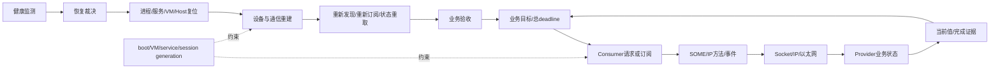

# Week 14 — 周五反思总结：VM 看门狗、SOME/IP 新鲜度与恢复闭环

学习日期：2026-10-16，星期五，Asia/Shanghai；Week 14。能力阶段：第二阶段“系统链路与问题分析”。今天只复盘本周实际安排的 Day 42—44，不推进 Day、不提前讲 Day 45。建议用时 60 分钟。

执行前已完整分页扫描仓库全部状态的 Issue；仓库当前没有答卷 Issue，因此没有新答卷、编辑版本或本人 `[补交]` 评论。本聊天也没有新增真实作答。Day 34—44 继续记为待评审，本课不虚构掌握情况或个人薄弱点。

## 1. 本周范围与审计边界

| 单元 | 计划学习日 | 本次复盘能力 |
| --- | --- | --- |
| [Day 42：Hypervisor / VM Reset II](https://qiantao18817568425-art.github.io/Architecture_Learning-/lessons/day-42.html) | 10 月 12 日，星期一 | 区分检测、裁决、执行、状态重建和业务验收；明确看门狗责任与恢复半径 |
| [Day 43：Ethernet / SOME-IP I](https://qiantao18817568425-art.github.io/Architecture_Learning-/lessons/day-43.html) | 10 月 13 日，星期二 | 把链路、IP、传输、服务发现、方法/事件与业务新鲜度分层 |
| [Day 44：Ethernet / SOME-IP II](https://qiantao18817568425-art.github.io/Architecture_Learning-/lessons/day-44.html) | 10 月 14 日，星期三 | 用故障范围、恢复阶梯、旧消息隔离和测试矩阵完成闭环 |

三课均于 2026-10-15 按用户要求补录，计划日期、实际发布时间和学习证据分别记录。今天的复盘不能把“已发布”写成“已学习”。

官方资料复核日期：2026-10-16。今天不新增专题，只复核本周已用边界：

- [AUTOSAR SOME/IP Protocol Specification R21-11](https://www.autosar.org/fileadmin/standards/R21-11/FO/AUTOSAR_PRS_SOMEIPProtocol.pdf)：复核请求/响应、事件与会话关联；传输成功不等于业务状态生效。
- [AUTOSAR SOME/IP Service Discovery Protocol Specification R21-11](https://www.autosar.org/fileadmin/standards/R21-11/FO/AUTOSAR_PRS_SOMEIPServiceDiscoveryProtocol.pdf)：复核 Offer、Find、订阅、TTL 与服务可用性边界。
- [Linux 网络接口运行状态](https://docs.kernel.org/networking/operstates.html)：复核 carrier、operstate 与上层业务可用性的区别。
- [OASIS Virtio 1.3](https://docs.oasis-open.org/virtio/virtio/v1.3/virtio-v1.3.html)：复核 reset 后设备与队列重建、旧 descriptor/完成通知的代际边界。
- [RFC 9293：TCP](https://www.rfc-editor.org/rfc/rfc9293) 与 [RFC 8085：UDP 使用指南](https://www.rfc-editor.org/rfc/rfc8085)：复核传输层确认、超时、重复与拥塞语义，避免把 socket 成功扩写为业务完成。

当前仍缺车型、SoC、硬件阶段、Android/Yocto/Hypervisor 版本、实际以太网拓扑、SOME/IP 配置、服务 ID、实例 ID、TTL、超时预算、看门狗门限和实机日志。本文案例与数值均为教学构造或待项目确认。

本次从 `F:/座舱日志分析/交付物/T12T诊断技能家族-优化版/` 读取并检查全部 21 项技能入口；深入使用平台架构、日志分析、虚拟化、稳定性、以太网、跨域消息和 TPM 分责。

## 2. 一小时安排

| 时间 | 任务 | 产出 |
| --- | --- | --- |
| 0—10 分钟 | 独立回答 5 道回顾题 | 短答；不确定项标“待确认” |
| 10—30 分钟 | 重画本周知识地图 | 四条流、三种代际与业务完成条件 |
| 30—50 分钟 | 完成综合故障题 | 异常时序、证据账本、竞争假设、恢复方案 |
| 50—60 分钟 | 写个人反思 | 《跨域服务恢复评审卡 V1》 |

回顾题不附参考答案：

1. VM 看门狗检测到“无响应”后，检测者、恢复裁决者、复位执行者、状态重建者和业务验收者为什么不能默认是同一个模块？
2. Ethernet carrier up、获得 IP、SOME/IP Offer 可见、订阅 ACK 和业务值新鲜分别证明到哪一层？
3. 方法响应成功后，为什么仍要回读状态或等待当前 generation 的事件才能宣布业务完成？
4. 服务重连后，旧订阅、旧 session、旧 event sequence 和缓存值应怎样失效或重新建立？
5. “重启 VM 后恢复”能支持哪种恢复覆盖判断？还缺哪些证据才能确定根因和最终责任？

## 3. 知识地图：恢复链与业务链必须闭合

复盘时至少分开四条路径：

| 路径 | 要追踪的对象 | 不能替代的完成证据 |
| --- | --- | --- |
| 控制流 | Find/Offer、订阅、方法调用、恢复命令 | 命令被接受不等于状态已重建 |
| 数据流 | 事件 payload、方法返回、业务值 | 收到字节不等于数据仍新鲜 |
| 状态流 | link/IP/service/subscription/business state | service available 不等于业务 ready |
| 电源/生命周期 | VM、虚拟设备、PHY、Provider/Consumer 生命周期 | 进程存活不等于接口与缓存已恢复 |

### 3.1 三种代际

- **运行代际：**boot、VM、service/device generation。
- **通信代际：**connection、session、subscription、event sequence。
- **业务代际：**request、目标值、状态版本、deadline。

恢复后必须说明谁创建新代际、谁拒绝旧代际、谁重新获取实态、谁宣布业务完成。

## 4. 综合故障题：VM 恢复后服务在线但空调状态冻结

以下为教学构造记录，不预设根因。不同域原始时钟尚未校准，序号只表示采集到的逻辑顺序。

| 编号 | 构造记录 |
| --- | --- |
| E1 | Consumer 在 VM generation g17 中收到空调服务 Offer，TTL 尚未到期 |
| E2 | Consumer 发出订阅请求并记录 ACK；日志未给出 ACK 的具体语义 |
| E3 | Provider 周期事件 sequence 从 890 增至 894，随后没有新事件 |
| E4 | Ethernet carrier 和 IP 地址保持正常；没有交换机端口、PHY 错误计数或抓包 |
| E5 | 健康监测因业务状态超时触发 VM 重建；触发源、裁决规则和恢复半径未记录完整 |
| E6 | VM generation 变为 g18，服务再次 Offer；Consumer UI 仍显示重建前缓存值 |
| E7 | Consumer 发起一次 GET，收到 transport success；返回值、服务 generation 与 UI 应用记录缺失 |
| E8 | 人工重启 Provider 后，新事件到达且 UI 更新；该动作只证明扩大恢复后业务恢复 |

### 4.1 必交任务

1. 画异常时序，包含 Consumer、SOME/IP 栈、Guest/VM、Host 网络、Provider、PHY/交换机和业务验收方。每个箭头标控制、数据、状态或生命周期。
2. 找出“最后一个已证实成功交接”和“下一个预期输出”。日志缺失只能写未闭环，不能直接写失败。
3. 提出至少三个竞争假设，分别覆盖 Consumer 恢复、订阅/事件链、Provider 状态或网络路径；为每个假设给出反证和最小区分实验。
4. 解释 E2 的 ACK、E7 的 transport success 与“空调状态已恢复”之间还缺哪些完成条件。
5. 设计 g17→g18 的旧消息处理：旧订阅、旧事件、缓存值、迟到响应、重复回调和 sequence 回退分别怎样处理。
6. 比较四级恢复：重新订阅/重取状态、重连服务、重启 Provider、重建 VM。写影响面、证据损失、恢复预算、共享业务风险和升级条件。
7. 给出测试闭环：正常启动、Provider 先启动/后启动、TTL 到期、丢包/乱序/重复、VM 重建、Provider 重启、旧事件迟到、连续恢复 20 轮。未执行项目标待执行。
8. 完成 TPM 分责：首轮牵头、触发方候选、直接失效修复方、恢复策略方、验证方；人员和期限未知时写待确认。

### 4.2 证据账本

| 编号 | 原始文件/行号 | 时钟与域 | boot/VM/service/session generation | service/instance/method/event/sequence | 原始事实 | 支持/反驳 | 覆盖边界 |
| --- | --- | --- | --- | --- | --- | --- | --- |
| E1… |  |  |  |  |  |  |  |

再提交一张竞争假设表：

| 假设 | 支持证据 | 反证 | 缺失证据 | 最小区分实验 | 通过/否定判据 |
| --- | --- | --- | --- | --- | --- |

## 5. 可复用产物：《跨域服务恢复评审卡 V1》

请用一页正文加一张图完成：

1. 车型、版本、VM/网络/服务部署与实际接口边界。
2. 业务目标、开始点、总 deadline 和可验证完成条件。
3. 控制、数据、状态、生命周期路径及每个接口观测点。
4. boot/VM/service/session/business generation 和关联 ID。
5. ACK、局部完成、业务完成、结果未知、超时、取消、重试、幂等和旧消息规则。
6. 最早可证实断点、竞争假设、反证和证据缺口。
7. 最小恢复到扩大恢复的阶梯、退出条件和证据保护。
8. 正常、异常、恢复、共享资源和相邻业务回归矩阵。

个人反思由你本人填写：

- 本周我最容易把哪一个“在线/成功”误认为业务完成？
- 我的故障分析在哪一层最常缺少 generation 或对象关联？
- 如果只能新增三个埋点，我会放在哪里，怎样让它们能跨 VM 与服务重启关联？
- 哪个恢复动作目前过大？我怎样用证据缩小恢复半径？

## 6. 提交与后续

本课编号 **week-14-friday**。提交内容：5 道回顾题、知识地图、综合故障题、异常时序、证据账本、竞争假设表、《跨域服务恢复评审卡 V1》和个人反思。题目不附标准答案；收到真实作答后再逐题批改。

使用页面末尾“上传／提交答卷”，或进入[答卷中心](https://qiantao18817568425-art.github.io/Architecture_Learning-/answers/index.html)。仓库、答卷与批改公开，请只提交可公开、已脱敏的学习材料。

周六只围绕 Day 42—44 做巩固、独立作答、画图与证据链训练；周日只做跨层取证、恢复设计、测试闭环与方案整合。Day 45 保留到 2026-10-19 星期一。

## 附录：21 项 T12T 技能覆盖

| 技能组 | 判断 | 本次处理 |
| --- | --- | --- |
| cockpit-diagnosis / log-analysis / platform-architecture | 适用，深入 | 定义现象、版本、时间、运行域，重建跨域链并寻找最早未闭环点 |
| virtualization-tee / stability-crash-reset | 适用，深入 | VM 代际、虚拟设备重建、复位层级与恢复半径 |
| ethernet-sgmii / cross-domain-msg | 适用，深入 | link/IP/service/session/sequence/新鲜度分层和旧消息隔离 |
| tpm-triage | 适用，深入 | 区分首轮牵头、触发候选、直接修复、策略与验证责任 |
| boot-hmi / performance-jank / power-sleep-str / mcu | 材料不足 | 可能影响 ready、deadline、电源和上游状态，但本题无实机证据 |
| display / touch / camera / audio / wireless / USB-storage | 本题不适用 | 不扩写为本次主链，也不据此排除实车共因 |
| log-storm / db-ke-forensics | 材料不足 | 没有覆盖、DB/KE、panic、tombstone 或符号化材料 |
| tpm-5y8d | 暂不展开 | 根因与逃逸原因未证实，不强行形成 5Y/8D |

关键证据缺口：现车版本和部署、SOME/IP 配置与 ID、TTL/超时/重试策略、全域时钟锚点、VM/service/session generation、抓包与 Provider/Consumer 状态、恢复调用链、真实完成证据和回归结果。补齐前结论仅能停留在初步责任域与可证伪假设。

