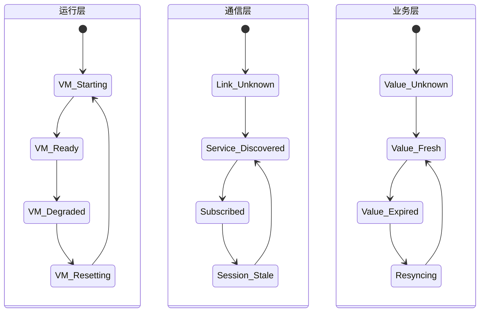
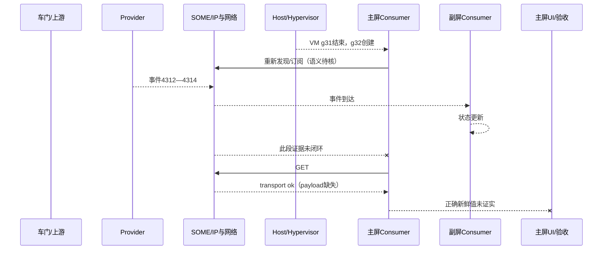

# Week 14 — 周六巩固：恢复决策、代际隔离与 SOME/IP 证据链训练

学习日期：2026-10-17，星期六，Asia/Shanghai；Week 14。能力阶段：第二阶段“系统链路与问题分析”。今天只巩固本周已经安排的 Day 42—44，不推进 Day、不提前讲 Day 45，也不加入新的普通专题。建议用时 60 分钟。

执行前已完整扫描仓库全部状态的 Issue；当前没有答卷 Issue、编辑版本或本人 `[补交]` 评论，本聊天也没有新增真实作答。因此 Day 34—44 仍为待评审。本课只提供独立作答、画图和证据链训练，不写参考答案、不预设根因、不代写个人反思。

## 1. 范围、资料和项目边界

| 已安排单元 | 今天的巩固重点 |
| --- | --- |
| [Day 42：看门狗责任与恢复策略](https://qiantao18817568425-art.github.io/Architecture_Learning-/lessons/day-42.html) | 检测、裁决、执行、状态重建和业务验收的责任分离；恢复半径与失败出口 |
| [Day 43：服务可用性、会话与数据新鲜度](https://qiantao18817568425-art.github.io/Architecture_Learning-/lessons/day-43.html) | Link/IP/传输/发现/订阅/业务值的分层；会话与新鲜度 |
| [Day 44：故障隔离、恢复策略与测试闭环](https://qiantao18817568425-art.github.io/Architecture_Learning-/lessons/day-44.html) | 故障范围、恢复阶梯、旧消息处理、证据与验证闭环 |

三课于 2026-10-15 补录；计划日期、实际发布时间和学习证据保持分开。本次发布不把材料存在写成已经学习或掌握。

官方资料复核日期：2026-10-17：

- [AUTOSAR SOME/IP Protocol Specification R21-11](https://www.autosar.org/fileadmin/standards/R21-11/FO/AUTOSAR_PRS_SOMEIPProtocol.pdf)：复核 RPC、事件通知、消息序列与协议语义。
- [AUTOSAR SOME/IP Service Discovery Protocol Specification R21-11](https://www.autosar.org/fileadmin/standards/R21-11/FO/AUTOSAR_PRS_SOMEIPServiceDiscoveryProtocol.pdf)：复核 Find/Offer、订阅、TTL 与服务发现边界。
- [Linux 网络接口运行状态](https://docs.kernel.org/networking/operstates.html)：复核 admin state、carrier、operstate 与用户数据可用性的区别。
- [OASIS Virtio 1.3](https://docs.oasis-open.org/virtio/virtio/v1.3/virtio-v1.3.html)：复核 device/virtqueue reset 后的重新初始化和旧队列边界。
- [RFC 9293：TCP](https://www.rfc-editor.org/rfc/rfc9293) 与 [RFC 8085：UDP 使用指南](https://www.rfc-editor.org/rfc/rfc8085)：复核传输确认、重传、重复、拥塞和超时不能替代业务完成。

当前没有车型、SoC、硬件阶段、Android/Yocto/Hypervisor 版本、物理网络拓扑、SOME/IP 配置、服务和实例 ID、TTL、看门狗阈值、时限预算或实机日志。下文全部是教学构造；数值、接口、错误码与恢复策略须按项目版本确认。

本次从 `F:/座舱日志分析/交付物/T12T诊断技能家族-优化版/` 读取并检查全部 21 项技能入口；深入使用通用三入口、虚拟化、稳定性、以太网、跨域消息和 TPM 分责专项。

## 2. 一小时安排

| 时间 | 独立任务 | 必交产出 |
| --- | --- | --- |
| 0—10 分钟 | 回答 5 道回顾题 | 5 条短答，未知项标“待确认” |
| 10—25 分钟 | 画三层状态图 | VM/服务、通信会话、业务新鲜度三层状态 |
| 25—45 分钟 | 分析综合案例 | 异常时序、最早未闭环点、竞争假设 |
| 45—55 分钟 | 建证据链与恢复决策表 | 证据账本、恢复阶梯、区分实验 |
| 55—60 分钟 | 个人反思 | 一条易错认知、一条改进动作 |

### 2.1 回顾题

1. 看门狗“超时”是事实、故障定位还是恢复触发？必须附带哪些对象、代际和时钟信息？
2. Offer 可见、订阅 ACK、事件到达、业务值新鲜、UI 更新分别属于哪一层的完成？
3. 为什么 VM generation 已更新，SOME/IP session、订阅关系和业务缓存仍可能保留旧语义？
4. transport success 后哪些情况会使业务结果仍然未知？怎样查询当前实态而不重复制造副作用？
5. 选择恢复层级时，怎样用故障范围、恢复预算、共享资源影响和证据保护共同决策？

## 3. 画图训练：三层状态必须对齐

请先独立重画下图，不要直接照抄。为每个状态补充进入条件、退出条件、超时、观测点和 Owner。

图后回答：

1. 哪些跨层转换需要 generation fence？
2. 哪个模块负责把旧缓存从“可显示”变为“未知/已过期”？
3. VM Ready 是否允许通信层直接进入 Subscribed？还缺什么证据？
4. Resyncing 超时后是重试、升级恢复还是进入降级？决定依据是什么？
5. 三层分别使用什么时钟；跨域时怎样建立共同锚点？

## 4. 综合案例：VM 重建后车门状态只在主屏冻结

以下记录是教学构造，日志来自不同运行域且尚未完成时钟校准。编号表示收集顺序，不表示可直接相减的统一时间。题目没有预设根因。

### 4.1 现象

- 车辆处于上电运行状态；主屏和副屏都订阅车门状态。
- 一次 Android Guest VM 重建后，副屏继续刷新，主屏一直显示重建前的“左前门关闭”。
- 再次开关车门后，Provider 侧状态正确；人工重启主屏 Consumer 后恢复。
- 没有提供当前车型、构建号、拓扑、抓包、VM reset 原因或物理车门录像。

### 4.2 构造记录

| 编号 | 记录 | 需核对的边界 |
| --- | --- | --- |
| E1 | Host 记录 VM g31 结束、g32 创建；reset request 带 reason=`health-timeout` | 触发对象、检测门限、裁决者和实际复位范围 |
| E2 | g32 中主屏 Consumer 记录 `service available` | 是发现、连接还是业务 ready；service generation 缺失 |
| E3 | 主屏记录 Subscribe ACK，client/session=`07/19` | ACK 语义、旧 session 是否复用、事件组和 TTL |
| E4 | Provider 记录车门事件 sequence 4312、4313、4314 | 是否发到两个 Consumer；payload、instance 和服务代际 |
| E5 | 副屏记录 sequence 4312—4314 并更新 UI | Provider 与部分网络路径可用的范围；不能自动证明主屏路径 |
| E6 | 主屏只记录 g31 缓存值 sequence 4308，没有 4312—4314 | 缓存来源、过期策略、订阅与接收证据缺口 |
| E7 | Host 接口 operstate=UP；未给 PHY/交换机错误计数与抓包 | 只覆盖哪个接口和时窗；UP 不等于所有业务路径完成 |
| E8 | 主屏发 GET，记录 `transport ok`；没有响应 payload 与应用状态日志 | 传输层局部完成；业务结果仍未知 |
| E9 | 人工重启主屏 Consumer，新 session=`09/03`，收到 sequence 4320 | 恢复覆盖范围；不能独立证明此前唯一根因 |
| E10 | 没有旧 g31 的迟到事件、重复事件或拒绝日志 | 未观测不等于没有发生；需明确观测能力 |

### 4.3 必须独立完成的异常时序

请在自己的图中补充：

- 每条消息的控制/数据/状态/生命周期分类；
- boot、VM、service、connection、session、subscription、business generation；
- request、client/session、event group、sequence、状态版本；
- ACK、局部完成、业务完成和结果未知；
- 超时、复位、迟到消息、重复消息与缓存过期；
- 观察点、时钟域和共同锚点。

## 5. 证据链训练

### 5.1 最早未闭环点

先写出：

- 最后一个已证实成功交接；
- 下一个预期输出；
- 该输出是明确失败、没有观测，还是无法关联；
- 能否被 E5、E7、E9 支持或反驳；
- 当前可以划到哪个初步责任域，不能划到哪里。

### 5.2 竞争假设

至少提出三个假设，不预设正确答案：

| 假设 | 支持证据 | 反证 | 关键缺口 | 单变量区分实验 | 成立/否定判据 |
| --- | --- | --- | --- | --- | --- |
| H1 |  |  |  |  |  |
| H2 |  |  |  |  |  |
| H3 |  |  |  |  |  |

假设必须覆盖不同接口边界，例如：订阅关系没有真正重建、事件到达但被旧代际过滤、事件已进入 Consumer 但业务缓存或 UI 没更新。这里只给分类边界，不给答案。

### 5.3 证据账本

| 证据 | 来源/行号 | 原始时钟与域 | 代际与对象 ID | 原始事实 | 证据类型 | 支持/反驳 | 覆盖边界 |
| --- | --- | --- | --- | --- | --- | --- | --- |
| E1…E10 |  |  |  |  | 直接/相关/反证/背景/缺失 |  |  |

## 6. 恢复决策训练

为以下候选动作填写完整表格：

| 候选恢复 | 触发条件 | 前置证据 | 影响面 | 证据损失 | 预算 | 失败出口 | 业务完成判据 |
| --- | --- | --- | --- | --- | --- | --- | --- |
| 业务重取当前状态 |  |  |  |  |  |  |  |
| 重新订阅/重连 |  |  |  |  |  |  |  |
| 重启主屏 Consumer |  |  |  |  |  |  |  |
| 重启 Provider |  |  |  |  |  |  |  |
| 重建 Guest VM |  |  |  |  |  |  |  |

再回答：

1. 哪个动作是你在当前证据下的最小候选？为什么只是候选？
2. 何种观察会要求扩大恢复半径？
3. 每个动作前应保存哪些证据，避免恢复成功后无法定位？
4. 如何防止旧 g31 事件或响应覆盖 g32 的新结果？
5. 如何验证主屏恢复时副屏和其他共享业务没有回归？

## 7. 可执行验证矩阵

| 用例 | 注入或步骤 | 观测点 | 预期结果 | 反例 | 回退 | 状态 |
| --- | --- | --- | --- | --- | --- | --- |
| 正常启动 | Provider/Consumer 不同启动顺序 | Offer、订阅、首个新鲜值 |  |  |  | 待执行 |
| VM 重建 | 在事件发送前/中/后重建 Guest | generation、session、sequence |  |  |  | 待执行 |
| 旧消息迟到 | 延迟 g31 响应或事件 | 丢弃原因与计数 |  |  |  | 待执行 |
| 重复与乱序 | 重复/调换 sequence | 状态版本与 UI |  |  |  | 待执行 |
| TTL/断链 | 让 Offer/订阅过期再恢复 | SD、重订阅、状态重取 |  |  |  | 待执行 |
| 共享业务 | 主屏恢复时持续操作副屏 | 两侧业务验收 |  |  |  | 待执行 |
| 连续恢复 | 重复 20 轮 | 资源、队列、会话、时限 |  |  |  | 待执行 |

## 8. 可复用产物：《跨域恢复证据包 V1》

提交一个可复用模板，至少包含：

1. 项目身份和版本；
2. 四条路径与跨域边界图；
3. 三层状态和全部 generation；
4. 完成语义与时限预算；
5. 异常时序和最早未闭环点；
6. 证据账本和竞争假设；
7. 恢复决策表；
8. 测试矩阵；
9. TPM 分责表：首轮牵头、触发候选、直接修复、接口/恢复策略、验证；
10. 未确认项和下一次取证清单。

个人反思由你本人填写：

- 今天哪一条证据最容易被我过度解释？
- 我是否把“没有日志”写成了“没有发生”？
- 我选择的恢复动作是否大于当前已证明的故障范围？
- 下次面对“重启后恢复”，我先保全哪三类证据？

## 9. 提交说明

本课编号 **week-14-saturday**。请提交：5 道回顾题、三层状态图、异常时序、最早未闭环点、竞争假设表、证据账本、恢复决策表、验证矩阵、《跨域恢复证据包 V1》和个人反思。

使用页面末尾“上传／提交答卷”，或进入[答卷中心](https://qiantao18817568425-art.github.io/Architecture_Learning-/answers/index.html)。答卷、附件与批改公开，请只提交可公开且已脱敏的学习材料。编辑原答卷或本人以 `[补交]` 开头评论会生成新版本并重新评审。

## 附录：21 项 T12T 技能覆盖检查

| 技能 | 本次判断 |
| --- | --- |
| t12t-cockpit-diagnosis | 适用，深入：定义现象、范围、版本、时间与运行域 |
| t12t-log-analysis | 适用，深入：跨域时间、代际、最早未闭环点与证据类型 |
| t12t-platform-architecture | 适用，深入：控制、数据、状态、生命周期路径和边界 |
| t12t-display-black-freeze | 本题不适用：没有显示链故障证据，UI 状态仅作业务验收 |
| t12t-touch-input | 本题不适用：没有触摸输入现象 |
| t12t-avm-camera-stream | 本题不适用：没有 Camera/AVM 链路 |
| t12t-power-sleep-str | 材料不足：有 VM 生命周期但没有 STR/电源状态转换证据 |
| t12t-audio-path | 本题不适用：没有音频链路 |
| t12t-stability-crash-reset | 适用，深入：VM/进程复位层级、触发与恢复半径 |
| t12t-performance-jank | 材料不足：没有 CPU、调度、内存、I/O 或连续时延数据 |
| t12t-ethernet-sgmii | 适用，深入：carrier/operstate 与业务链分层、物理证据缺口 |
| t12t-wireless-phone-link | 本题不适用：没有无线或手机互联 |
| t12t-cross-domain-msg | 适用，深入：服务、会话、sequence、新鲜度和旧消息隔离 |
| t12t-boot-hmi | 材料不足：涉及 VM 重建后的 ready，但无启动里程碑 |
| t12t-log-storm | 材料不足：没有刷屏、丢日志、轮转或存储压力证据 |
| t12t-usb-typec-storage | 本题不适用：没有 USB 或存储链路 |
| t12t-virtualization-tee | 适用，深入：VM generation、虚拟设备/队列重建；无 TEE 证据 |
| t12t-db-ke-forensics | 材料不足：没有 AEE/DB、KE、panic、tombstone 或符号 |
| t12t-mcu | 材料不足：上游车门状态涉及 MCU 的可能性待拓扑确认 |
| t12t-tpm-triage | 适用，深入：首轮牵头与触发、修复、策略、验证责任分离 |
| t12t-tpm-5y8d | 暂不展开：根因和逃逸原因未证实，不强行写 5Y/8D |

关键证据缺口：现车拓扑与版本、上游状态源、SOME/IP 配置、服务/实例/事件组、TTL、VM/service/session generation、跨域时钟映射、Provider/Consumer 原始日志、抓包、恢复调用链、物理动作与 UI 同步录像、重复恢复测试结果。

