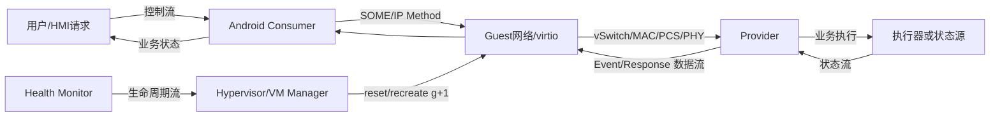
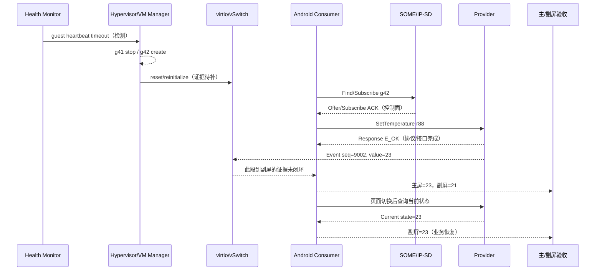

# Week 14 — 周日整合：VM—SOME/IP 跨层取证、恢复设计与测试闭环

学习日期：2026-10-18，星期日，Asia/Shanghai；Week 14。能力阶段：第二阶段“系统链路与问题分析”。今天只整合本周已经安排的 Day 42—44，不推进 Day、不提前讲 Day 45。建议用时 60 分钟。

执行前已完整扫描仓库全部状态的 Issue；当前没有答卷 Issue、编辑版本或本人 `[补交]` 评论，本聊天也没有新增真实作答。因此 Day 34—44 仍为待评审。本课给出跨层取证、恢复方案和测试闭环任务，不附参考答案、不预设根因、不代写个人反思。

## 1. 范围、依据与项目边界

| 已安排单元 | 今天的整合任务 |
| --- | --- |
| [Day 42：看门狗责任与恢复策略](https://qiantao18817568425-art.github.io/Architecture_Learning-/lessons/day-42.html) | 分离检测、裁决、执行、状态重建和业务验收 |
| [Day 43：服务可用性、会话与数据新鲜度](https://qiantao18817568425-art.github.io/Architecture_Learning-/lessons/day-43.html) | 对齐 Link、IP、传输、发现、订阅和业务新鲜度 |
| [Day 44：故障隔离、恢复策略与测试闭环](https://qiantao18817568425-art.github.io/Architecture_Learning-/lessons/day-44.html) | 用故障范围、代际隔离、恢复阶梯和验证矩阵关闭问题 |

官方资料复核日期：2026-10-18：

- [AUTOSAR SOME/IP Protocol Specification R21-11](https://www.autosar.org/fileadmin/standards/R21-11/FO/AUTOSAR_PRS_SOMEIPProtocol.pdf)：复核 RPC、事件通知、消息序列和协议语义。
- [AUTOSAR SOME/IP Service Discovery Protocol Specification R21-11](https://www.autosar.org/fileadmin/standards/R21-11/FO/AUTOSAR_PRS_SOMEIPServiceDiscoveryProtocol.pdf)：复核 Find/Offer、Subscribe、TTL 和服务发现状态边界。
- [Linux Operational States](https://docs.kernel.org/networking/operstates.html)：复核管理状态、carrier、operstate 与用户数据可用性的区别。
- [OASIS Virtio 1.3](https://docs.oasis-open.org/virtio/virtio/v1.3/virtio-v1.3.html)：复核 device/virtqueue reset、状态归零、重新初始化和旧队列隔离。
- [RFC 9293：TCP](https://www.rfc-editor.org/rfc/rfc9293) 与 [RFC 8085：UDP 使用指南](https://www.rfc-editor.org/rfc/rfc8085)：复核传输状态、复位、超时、重复和乱序不能替代业务完成。

当前没有车型、SoC、硬件阶段、Android/Yocto/Hypervisor 版本、网络拓扑、服务部署、SOME/IP 参数、看门狗阈值、时限预算或实机日志。下文是教学构造；接口、ID、错误码、TTL、重试次数和恢复门槛均须按项目版本确认。

本次从 `F:/座舱日志分析/交付物/T12T诊断技能家族-优化版/` 读取并检查全部 21 项技能入口；深入使用通用三入口、虚拟化、稳定性、以太网、跨域消息和 TPM 分责专项。

## 2. 一小时安排

| 时间 | 任务 | 必交产出 |
| --- | --- | --- |
| 0—10 分钟 | 回顾 5 题 | 5 条短答，未知项标“待确认” |
| 10—25 分钟 | 建四路架构图和代际表 | 控制、数据、状态、生命周期路径 |
| 25—45 分钟 | 完成跨层案例取证 | 异常时序、证据账本、竞争假设 |
| 45—55 分钟 | 设计恢复与测试闭环 | 恢复阶梯、预算、退出和验证矩阵 |
| 55—60 分钟 | 形成方案包与个人反思 | 《VM—SOME/IP 跨层恢复方案包 V1》 |

回顾题：

1. 看门狗超时、VM reset 接受、VM Ready、服务 Offer、Subscribe ACK、首个新鲜值和用户结果分别证明什么？
2. 为什么接口 `UP`、socket 建立或 RPC Response 都不能单独证明业务恢复？
3. VM generation 更新后，哪些通信和业务对象必须失效或重新绑定？
4. timeout 后怎样区分“未执行”“已执行但响应丢失”和“仍在执行”？
5. 恢复成功为什么只是覆盖范围证据，不能单独证明根因？

## 3. 方案骨架：四条路径与三层完成

先画出当前项目的真实路径；不知道的节点保留“待确认”，不要用教学图冒充现车拓扑。

为每一跳补充：输入、输出、状态、超时、代际、时钟、观测点和 Owner。至少区分：

| 层级 | 里程碑 | 只能证明 | 仍需证明 |
| --- | --- | --- | --- |
| 生命周期 | reset command ACK | 管理命令被接收或完成到约定阶段 | 新 VM 和资源完成初始化 |
| 虚拟设备 | DRIVER_OK / queue ready | 当前设备或队列可运行 | 网络、服务和业务状态已重建 |
| 网络 | carrier/operstate、IP、socket | 对应链路或端点局部可用 | 发现、订阅、数据与业务可用 |
| 服务控制面 | Offer、Subscribe ACK | 服务发现或订阅关系达到协议状态 | 当前代首事件和正确业务值 |
| 数据面 | Response/Event 到达 | 某消息到达 Consumer | 代际、新鲜度、幂等与状态应用正确 |
| 业务 | 状态读回/用户验收 | 目标结果满足合同 | 共享业务、异常恢复和连续运行无回归 |

## 4. 综合案例：VM 重建后 ACK 正常但状态分叉

以下记录均为教学构造。日志来自不同运行域，尚未完成时钟校准；编号表示收集顺序，不表示可以直接计算时差。题目没有预设根因。

### 4.1 现象与记录

- Android Guest 因健康监控裁决进入重建，Provider 所在域未重启；物理链路始终报告 Up。
- VM g42 启动后，空调目标温度设置请求收到 SOME/IP Response，主屏显示 23°C，副屏仍显示 21°C。
- Provider 查询接口随后返回 23°C；切换一次页面后副屏恢复。

| 编号 | 构造记录 | 需要核对的边界 |
| --- | --- | --- |
| E1 | Health Monitor 报 `guest-heartbeat-timeout`，VM Manager 接受 reset | 检测对象、阈值、时钟、裁决者、reset 范围 |
| E2 | Host 记录 g41 stop、g42 create；未提供 virtqueue 清理和 backend generation | 旧在途请求/通知是否被隔离 |
| E3 | g42 接口 operstate=UP，SOME/IP service available | 物理、虚拟、传输和发现分别覆盖到哪里 |
| E4 | Consumer 收到 Subscribe ACK，client/session=`12/07` | ACK 是否绑定 g42；eventgroup、TTL 和旧订阅状态 |
| E5 | g42 发 SetTemperature request=`r88`，收到 Response E_OK | Response 的完成语义；业务动作是否同步 |
| E6 | Provider 记录当前目标值 23°C，并发送 event sequence 9002 | source、publish 和发送侧闭环；目标 Consumer 列表未知 |
| E7 | 主屏收到 sequence 9002 并显示 23°C | 主屏路径与当前值可用 |
| E8 | 副屏在 g42 后先处理 sequence 8998，显示 21°C；未见拒绝理由 | 消息属于何代；缓存、路由、过滤或观测缺口 |
| E9 | 副屏没有 sequence 9002 的接收或丢弃记录 | 没有观测不等于没有发生 |
| E10 | 页面切换触发状态重取，副屏显示 23°C | 重取覆盖了哪些状态；不能独立证明唯一根因 |
| E11 | 未提供抓包、Provider fan-out、Guest route、vSwitch/virtio counters | 跨层证据链仍有断点 |

### 4.2 独立完成异常时序

在自己的时序图中补齐：boot/VM/device/service/connection/session/subscription/business generation、request ID、event sequence、状态版本、旧消息拒绝、超时、恢复预算和每层完成判据。

## 5. 跨层取证：从事实到最早未闭环点

### 5.1 证据账本

| 证据 | 原始来源/行号 | 域与时钟 | 对象和代际 | 原始事实 | 证据类型 | 支持/反驳 | 覆盖边界 |
| --- | --- | --- | --- | --- | --- | --- | --- |
| E1…E11 |  |  |  |  | 直接/相关/反证/背景/缺失 |  |  |

必须单独写出：

1. 最后一个已证实成功交接；
2. 下一个预期输出；
3. 该输出是明确失败、没有观测，还是无法关联；
4. 当前能划到哪个初步责任域，不能划到哪里；
5. 哪项证据若补齐，最可能改变判断。

### 5.2 竞争假设与区分实验

至少提出三个跨不同边界的竞争假设。不要把 E10 的恢复动作直接写成根因。

| 假设 | 支持证据 | 反证 | 缺口 | 单变量区分实验 | 成立判据 | 否定判据 |
| --- | --- | --- | --- | --- | --- | --- |
| H1 |  |  |  |  |  |  |
| H2 |  |  |  |  |  |  |
| H3 |  |  |  |  |  |  |

假设范围可从虚拟队列旧项、SOME/IP 会话/订阅、Consumer 缓存与 UI 状态中选择，但必须由你根据证据建立，不预设其中任何一项成立。

## 6. 恢复方案：最小恢复、扩大条件和失败出口

先固定证据，再执行有边界的恢复。每个恢复动作都需要 incident ID、generation、剩余预算和业务验收。

| 候选动作 | 触发条件 | 前置证据 | 影响面 | 旧状态处理 | 超时/预算 | 扩大条件 | 失败出口 | 业务完成判据 |
| --- | --- | --- | --- | --- | --- | --- | --- | --- |
| 丢弃旧代并重取当前状态 |  |  |  |  |  |  |  |  |
| 重建单 Consumer 缓存/订阅 |  |  |  |  |  |  |  |  |
| 重连 endpoint |  |  |  |  |  |  |  |  |
| 重启单服务 |  |  |  |  |  |  |  |  |
| reset 虚拟设备/队列 |  |  |  |  |  |  |  |  |
| 重建 Guest VM |  |  |  |  |  |  |  |  |

方案必须回答：

- 哪一个是当前证据下的最小候选，为什么仍只是候选？
- ACK、操作完成、状态重建和用户可见完成分别由谁确认？
- timeout 后怎样查询最终状态，避免非幂等请求重复执行？
- 旧 g41 response/event 到达时按哪些字段拒绝，拒绝记录保存在哪里？
- recovery coordinator 怎样限制多层重试总次数和总时长？
- 最小恢复失败到扩大恢复之间，哪些证据必须先保存？
- 达到恢复上限后进入何种降级、告警、人工介入或安全状态？

## 7. 测试闭环矩阵

数值和预期时限全部按项目合同填写；本表只规定覆盖维度。

| 场景 | 注入/步骤 | 观测点 | 预期结果 | 反例 | 回退 | 状态 |
| --- | --- | --- | --- | --- | --- | --- |
| 正常路径 | Provider/Consumer 不同启动顺序 | 生命周期、Offer、订阅、首值、UI |  |  |  | 待执行 |
| 早到/晚到 | 让请求或事件早于 ready、晚于 timeout | queue、session、sequence、拒绝理由 |  |  |  | 待执行 |
| VM reset | 在 request 前/中/后重建 Guest | generation、在途请求、重取 |  |  |  | 待执行 |
| Provider reset | Consumer 与链路保持运行 | Offer/TTL、重订阅、首个新鲜值 |  |  |  | 待执行 |
| Link flap | 受控 down/up | PCS/PHY、carrier、IP、SD、业务 |  |  |  | 待执行 |
| TTL 过期 | 停止 Offer 或订阅续租 | 服务不可用、缓存过期、恢复 |  |  |  | 待执行 |
| 旧响应/事件 | 延迟 g41 消息到 g42 | generation fence、丢弃日志 |  |  |  | 待执行 |
| 重复/乱序 | 重复并调换 sequence | 幂等、状态版本、UI |  |  |  | 待执行 |
| 共享消费者 | 主屏恢复时持续操作副屏 | fan-out、两侧状态和时限 |  |  |  | 待执行 |
| 连续恢复 | 重复项目规定轮次 | 资源、队列、会话、日志、总预算 |  |  |  | 待执行 |

每个用例必须记录版本、环境、触发时刻、原始证据、期望与实测、通过/失败理由和缺陷链接。没有实测就保持“待执行”，不能写成已通过。

## 8. TPM 分责与关闭

| 角色 | 首轮问题 | 所需证据 | 关闭判据 |
| --- | --- | --- | --- |
| Health/VM Owner | 谁检测、谁裁决、实际 reset 到哪一层？ | timeout 原始记录、调用链、g41/g42 生命周期 | 触发和范围可关联、无重复恢复风暴 |
| Virtualization Owner | 旧 virtqueue/backend 状态如何清理与重建？ | device status、queue index、generation、counters | 旧代不可进入新代，初始化闭环 |
| Network Owner | 物理、虚拟和 L3 路径分别是否可用？ | PHY/PCS/MAC、operstate、route、抓包 | 同窗路径证据与异常边界明确 |
| SOME/IP Owner | Offer、订阅、session、TTL 和 event 如何绑定代际？ | SD 状态、Request ID、eventgroup、sequence | 新代控制面和数据面都闭环 |
| Provider Owner | source、执行、current state 和 publish 是否一致？ | 请求/执行/状态版本/fan-out 日志 | 读回与事件同一当前状态 |
| Consumer/HMI Owner | 缓存何时失效，何时允许显示？ | 接收、过滤、cache、UI commit | 旧值不冒充当前值，双屏一致 |
| TPM/测试 | 怎样统一时钟、样本、Owner 与验收？ | 证据账本、行动项、测试矩阵 | 所有必测场景有可复核结论 |

首轮牵头、触发方、直接修复方、接口/恢复策略方和验证方可以不同。人员与期限当前均待确认；责任以最早可证实断点和接口合同为依据。

## 9. 今日交付：《VM—SOME/IP 跨层恢复方案包 V1》

请提交一个完整方案包，至少包含：

1. 项目身份、版本和材料范围；
2. 控制、数据、状态、生命周期四路架构图；
3. 三层完成合同与代际表；
4. 异常时序和统一时间方法；
5. 证据账本、最早未闭环点和竞争假设；
6. 单变量区分实验；
7. 恢复阶梯、预算、旧消息处理和失败出口；
8. 十类测试闭环矩阵；
9. TPM 分责与关闭标准；
10. 未确认项和下一次取证清单。

个人反思由你本人填写：

- 我最容易把哪个局部 ACK 当成业务完成？
- 哪项“没有日志”被我误当成“没有发生”的风险最高？
- 我的恢复动作是否超过了已证明的故障范围？
- 下次遇到“重启后恢复”，我会先固定哪三类证据？

## 10. 提交说明

本课编号 **week-14-sunday**。请提交 5 道回顾题、四路架构图、三层完成合同、异常时序、证据账本、最早未闭环点、至少 3 个竞争假设、恢复方案、测试矩阵、TPM 分责表、《VM—SOME/IP 跨层恢复方案包 V1》和个人反思。

使用页面末尾“上传／提交答卷”，或进入[答卷中心](https://qiantao18817568425-art.github.io/Architecture_Learning-/answers/index.html)。答卷、附件与批改公开，请只提交可公开且已脱敏的学习材料。编辑原答卷或本人以 `[补交]` 开头评论会生成新版本并重新评审。

## 附录：21 项 T12T 技能覆盖检查

| 技能 | 本次判断 |
| --- | --- |
| t12t-cockpit-diagnosis | 适用，深入：定义现象、版本、材料、时间和运行域 |
| t12t-log-analysis | 适用，深入：跨域时钟、代际、最早未闭环点和证据等级 |
| t12t-platform-architecture | 适用，深入：控制、数据、状态、生命周期路径和边界 |
| t12t-display-black-freeze | 材料不足：HMI 仅作业务验收，没有显示扫描链故障证据 |
| t12t-touch-input | 本题不适用：没有触摸输入现象 |
| t12t-avm-camera-stream | 本题不适用：没有 Camera/AVM 链路 |
| t12t-power-sleep-str | 材料不足：有生命周期变化，没有 STR/电源转换证据 |
| t12t-audio-path | 本题不适用：没有音频链路 |
| t12t-stability-crash-reset | 适用，深入：健康检测、VM 复位层级、恢复半径和失败出口 |
| t12t-performance-jank | 材料不足：没有 CPU、调度、内存、I/O 或连续时延数据 |
| t12t-ethernet-sgmii | 适用，深入：虚实网络分层、carrier/operstate 与业务可用性 |
| t12t-wireless-phone-link | 本题不适用：没有无线或手机互联 |
| t12t-cross-domain-msg | 适用，深入：服务、会话、序列、新鲜度和旧消息隔离 |
| t12t-boot-hmi | 材料不足：涉及 VM 启动和 HMI 状态重建，缺少完整启动里程碑 |
| t12t-log-storm | 材料不足：没有刷屏、轮转、丢日志或存储压力证据 |
| t12t-usb-typec-storage | 本题不适用：没有 USB 或存储链路 |
| t12t-virtualization-tee | 适用，深入：VM generation、virtio device/queue reset；无 TEE 证据 |
| t12t-db-ke-forensics | 材料不足：没有 AEE/DB、KE、panic、tombstone 或符号信息 |
| t12t-mcu | 材料不足：执行器或状态源是否经过 MCU 待现车拓扑确认 |
| t12t-tpm-triage | 适用，深入：首轮牵头、触发、修复、策略与验证责任分离 |
| t12t-tpm-5y8d | 暂不展开：根因与逃逸原因未证实，不强行写 5Y/8D |

关键证据缺口：现车车型和版本、物理与虚拟网络拓扑、服务部署、SOME/IP 配置、eventgroup/TTL/session 规则、虚拟设备状态、跨域时钟映射、Provider/Consumer 原始日志、抓包、业务状态源、恢复调用链、双屏同步录像与重复恢复实测。
