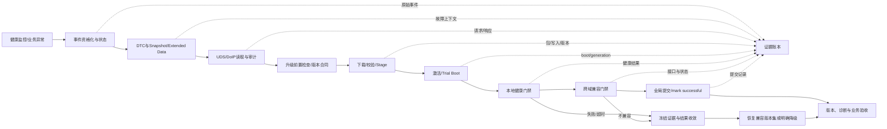

# Week 15 — 周五反思总结：诊断架构与 OTA / 回滚闭环

学习日期：2026-10-23，星期五，Asia/Shanghai；Week 15。能力阶段：第二阶段“系统链路与问题分析”。今天只复盘本周实际安排的 Day 45—48，不推进 Day 49，也不提前讲未来专题。建议用时 60 分钟。

执行前已完整分页扫描仓库全部状态的 Issue 与全库评论；仓库没有答卷 Issue、原答卷编辑、本人 `[补交]` 评论或附件，本聊天也没有新增真实作答。因此 Day 34—48 继续记为待评审；本文不把课程发布当作已经学习或掌握。

## 1. 本周范围与资料边界

| 单元 | 计划学习日 | 本次复盘能力 |
| --- | --- | --- |
| [Day 45：诊断架构 I](https://qiantao18817568425-art.github.io/Architecture_Learning-/lessons/day-45.html) | 10 月 19 日，星期一 | 健康监控、事件资格化、DTC、快照、持久化与跨复位证据 |
| [Day 46：诊断架构 II](https://qiantao18817568425-art.github.io/Architecture_Learning-/lessons/day-46.html) | 10 月 20 日，星期二 | tester—DoIP—路由—DCM—Dem 服务链，清除边界与闭环验证 |
| [Day 47：OTA / 回滚 I](https://qiantao18817568425-art.github.io/Architecture_Learning-/lessons/day-47.html) | 10 月 21 日，星期三 | 版本合同、A/B 安装状态机、首启确认、提交与失败回退 |
| [Day 48：OTA / 回滚 II](https://qiantao18817568425-art.github.io/Architecture_Learning-/lessons/day-48.html) | 10 月 22 日，星期四 | 多域依赖、staging barrier、跨域兼容、安全提交与整车恢复 |

Day 47—48 因用户明确要求于 2026-10-23 补充登记并首次发布；计划日期、实际发布时间和学习证据分别记录。本次复盘只覆盖这四课已经安排的内容。

官方资料复核日期：2026-10-23。今天不新增专题，只复用本周已核验的规范边界：

- [AUTOSAR Diagnostic Event Manager R22-11](https://www.autosar.org/fileadmin/standards/R22-11/CP/AUTOSAR_SWS_DiagnosticEventManager.pdf)：事件资格化、DTC 状态、事件内存、Snapshot/Extended Data 与清除边界。
- [AUTOSAR Diagnostic Communication Manager R22-11](https://www.autosar.org/fileadmin/standards/R22-11/CP/AUTOSAR_SWS_DiagnosticCommunicationManager.pdf)：诊断会话、安全条件、正负响应、P2/P2* 与 Dem/应用职责。
- [AUTOSAR Diagnostic over IP R22-11](https://www.autosar.org/fileadmin/standards/R22-11/CP/AUTOSAR_SWS_DiagnosticOverIP.pdf)：Routing Activation、诊断消息和 DoIP 正负 ACK 的语义边界。
- [AUTOSAR Adaptive Platform UCM R22-11](https://www.autosar.org/fileadmin/standards/R22-11/AP/AUTOSAR_SWS_UpdateAndConfigurationManagement.pdf)：软件包处理、激活、回滚与版本记录。
- [AUTOSAR Vehicle Update and Configuration Management](https://www.autosar.org/standards/adaptive-platform/vehicle-update-and-configuration-management)：整车级更新协调的职责入口。
- [AOSP OTA updates](https://source.android.com/docs/core/ota)、[A/B system updates](https://source.android.com/docs/core/ota/ab)、[bootloader OTA requirements](https://source.android.com/docs/core/architecture/bootloader/updating) 与 [Android Verified Boot](https://source.android.com/docs/security/features/verifiedboot)：A/B 写入、Slot 选择、首启、提交、回退和验证启动边界。

当前仍缺车型、SoC、硬件阶段、Android/Yocto/Hypervisor/MCU/TBox 版本、诊断字典、DoIP 路由、分区与双银行方案、实际 UCM/V-UCM 实现、版本兼容矩阵、安全启动与 rollback index、数据迁移规则、门限、时限和实机日志。以下故障记录均为教学构造，不代表当前车辆事实。

本次从 `F:/座舱日志分析/交付物/T12T诊断技能家族-优化版/` 重新读取并检查全部 21 项技能入口；深入使用平台架构、日志分析、跨域消息、稳定性复位、电源/STR、启动 HMI、虚拟化/TEE、MCU、DB/KE 取证与 TPM 分责。

## 2. 一小时安排

| 时间 | 任务 | 产出 |
| --- | --- | --- |
| 0—10 分钟 | 独立回答 5 道回顾题 | 短答；不确定项标“待确认” |
| 10—30 分钟 | 重画诊断—升级—恢复知识地图 | 控制、数据、状态、电源/生命周期与证据流 |
| 30—50 分钟 | 完成综合故障题 | 时序、证据账本、竞争假设、恢复与验证方案 |
| 50—60 分钟 | 形成评审卡并写个人反思 | 《诊断—升级—回滚闭环评审卡 V1》 |

回顾题不附参考答案：

1. 事件报告接口返回成功、事件 qualified、DTC stored、tester 读到 DTC 和用户功能恢复分别证明到哪一层？
2. DoIP 0x8002 正向 ACK、UDS 正响应、DTC 清除完成和复测不再出现之间还缺哪些完成条件？
3. payload 写入完成、目标 Slot 设为 active、新版本首启、本地健康通过和整车 campaign 提交为什么不能合并为一个“升级成功”？
4. 复位或重连后，怎样用 campaignId、transactionId、bootId、domain generation、版本 readback 和阶段序号拒绝旧响应与迟到 healthy？
5. 当安全回滚下限、数据格式和跨域协议版本互相约束时，怎样判断一个版本集合是否真能恢复业务？

## 3. 知识地图：诊断证据必须贯穿升级事务

复盘时必须分开五条路径：

| 路径 | 追踪对象 | 不能被替代的完成证据 |
| --- | --- | --- |
| 控制流 | 诊断请求、授权、下载、激活、提交、回滚命令 | 命令 ACK 不等于动作或业务完成 |
| 数据流 | DTC/快照、manifest、payload、签名、迁移数据 | 字节到达不等于内容适用或已生效 |
| 状态流 | 事件/DTC、包、Slot/银行、域版本、campaign | 单域状态不等于整车兼容状态 |
| 电源/生命周期 | boot、VM、进程、ECU、供电与唤醒代际 | 重启成功不等于证据、接口和业务已重建 |
| 证据流 | requestId、incidentId、campaignId、hash、readback、原始时间 | 页面显示或聚合状态不能替代原始证据 |

### 3.1 一条完成链的六个关口

1. **接收：**接口接受事件、诊断请求或升级命令。
2. **执行：**目标模块完成规定处理，给出最终响应或明确失败。
3. **持久：**状态、版本、证据与事务日志跨复位可恢复。
4. **运行：**目标版本进入新的 boot/domain generation 并通过本地门禁。
5. **兼容：**跨域接口、数据、诊断和用户链路对同一版本集合通过。
6. **提交：**权威版本、安全元数据和 campaign 终态按合同原子收敛。

任一层超时都要保留原总 deadline；复位后先 readback 再决定 resume、retry、rollback 或 manual recovery。结果未知不能直接重做有副作用步骤。旧 boot、旧连接、旧 campaign 或旧 generation 的回调不能推进当前事务。

## 4. 综合故障题：升级后版本分裂、唤醒信号不刷新

以下是教学构造记录，不预设根因。不同域时钟尚未完成对齐；编号只表示当前采集顺序。

| 编号 | 构造记录 | 当前能证明的边界 |
| --- | --- | --- |
| E1 | Orchestrator 记录 campaign C81；Android、Yocto、MCU 均返回 staged ACK | 各接口接受到 staged 层级；实际持久状态仍需 readback |
| E2 | 激活后 Android 设置页显示新版本，Android boot generation 从 A17 变为 A18 | Android 已进入新代；页面不是整车版本证据 |
| E3 | MCU staged ACK 存在，但激活后的版本 DID 仍返回旧版本 | MCU 当前 readback 与目标版本不一致；原因未知 |
| E4 | DoIP Routing Activation 与 0x8002 ACK 成功，随后一次 0x19 查询收到最终响应 | 本次通信与读取完成；未证明所有诊断数据与本次 campaign 同源 |
| E5 | 一条 0x14 清除请求在升级窗口内收到正响应；清除前 Snapshot 是否归档不明 | 清除动作完成到协议定义层；原始证据保护未知 |
| E6 | 车辆唤醒后，Android HMI 在线，但一组来自 MCU 的状态停止刷新 | 用户链路存在异常；最早跨域断点尚未建立 |
| E7 | Orchestrator journal 没有完整 staging barrier 成员、全局提交记录和 rollback index 时点 | 关键事务证据缺失；不能推断这些动作一定未发生 |
| E8 | 旧 campaign C80 的 Android healthy 回调在 C81 激活后到达 | 存在迟到消息；是否被采用仍需状态机证据 |
| E9 | 扩大复位后状态恢复，但 MCU 版本仍为旧版 | 证明该恢复动作覆盖了症状；不能独立证明根因 |

### 4.1 必交任务

1. 画异常时序，至少包含 tester、DoIP/router/DCM/Dem、OTA Orchestrator、Android Guest、Yocto/Hypervisor、MCU、Boot/安全存储和业务验收方。每个箭头标控制、数据、状态、证据或电源/生命周期。
2. 分别写出“最后一个已证实成功交接”和“下一个预期输出”。没有观测只能写未闭环，不能写成没有发生。
3. 提出至少四个竞争假设，覆盖：编排/barrier、MCU 激活与持久化、跨域消息/版本兼容、诊断证据清除或 readback 陈旧；每个假设都给反证和最小区分实验。
4. 解释 E1、E4、E5、E9 各自的 ACK/恢复边界，以及它们为什么不能证明整车 campaign 或业务已经完成。
5. 设计 C80→C81、A17→A18 与 MCU boot generation 的旧消息处理规则，包括迟到 healthy、重复 ACK、旧 DID 缓存、超时后响应和重试幂等。
6. 给出恢复决策：先冻结什么、读取什么、怎样选择兼容版本集合；比较局部重建、域回滚、整车回滚和明确降级的影响面、退出条件、证据损失与安全限制。
7. 设计验证矩阵，至少覆盖正常升级、staged 后掉电、激活中复位、旧回调迟到、DoIP 重连、DTC 清除前后、跨域版本不兼容、rollback index 阻止旧版、数据迁移不可逆、唤醒与连续 20 轮恢复。未执行项目写“待执行”。
8. 完成 TPM 分责：首轮牵头、触发方候选、直接失效修复方、接口/恢复策略方、安全审核方和验证方。未知人员与期限写“待确认”。

### 4.2 证据账本

| 编号 | 原始文件/行号 | 域与时钟 | boot/VM/domain generation | incident/request/campaign/transaction | 版本/阶段/readback | 原始事实 | 支持/反驳 | 覆盖边界 |
| --- | --- | --- | --- | --- | --- | --- | --- | --- |
| E1… |  |  |  |  |  |  |  |  |

再提交竞争假设表：

| 假设 | 支持证据 | 反证 | 缺失证据 | 最小区分实验 | 通过/否定判据 |
| --- | --- | --- | --- | --- | --- |

## 5. 可复用产物：《诊断—升级—回滚闭环评审卡 V1》

请用一页正文加两张图完成：

1. 车型、版本、ECU/VM/安全边界、更新承载与诊断拓扑。
2. 版本合同：基线、目标、依赖、回退目标、数据/接口兼容与安全下限。
3. 状态图：precheck、stage、activate、trial、local health、cross-domain compatible、commit/rollback/degraded。
4. 完成合同：传输 ACK、服务终态、写入、首启、本地健康、整车兼容、提交和业务验收。
5. 关联合同：vehicle/build/config、incident、tester request、campaign、transaction、boot/domain generation 与 monotonic phase。
6. 证据合同：DTC、Snapshot/Extended Data、版本 readback、journal、hash、boot reason、rollback reason、日志保留与隐私分级。
7. 异常合同：总 deadline、超时、复位、结果未知、旧消息拒绝、幂等重试、证据冻结与恢复阶梯。
8. 关闭合同：正常、异常、恢复、安全、共享资源、相邻业务与升级/回滚后诊断回归。

个人反思由你本人填写：

- 本周我最容易把哪一个局部 ACK 误认为业务完成？
- 我的证据链在哪个复位或清除动作后最容易断？
- 如果只能新增三个跨域关联字段或埋点，我会放在哪里，怎样证明它们贯穿同一 incident/campaign？
- 当前恢复动作中哪一步不可逆？我需要什么证据才允许执行？

## 6. 提交与后续

本课编号 **week-15-friday**。提交内容：5 道回顾题、知识地图、综合故障题、异常时序、证据账本、竞争假设表、验证矩阵、TPM 分责、《诊断—升级—回滚闭环评审卡 V1》和个人反思。题目不附标准答案；收到真实作答后再逐题批改。

使用页面末尾“上传／提交答卷”，或进入[答卷中心](https://qiantao18817568425-art.github.io/Architecture_Learning-/answers/index.html)。仓库、答卷与批改公开，请只提交可公开、已脱敏的学习材料。编辑原答卷或本人以 `[补交]` 开头评论会生成新版本并重新评审。

周六只围绕 Day 45—48 做巩固、综合案例、独立作答、画图和证据链训练；周日只做跨层取证、恢复设计、测试闭环和方案整合。两天都不新增普通 Day。

## 附录：21 项 T12T 技能覆盖

| 技能 | 适用性与本次处理 |
| --- | --- |
| t12t-cockpit-diagnosis | 适用，深入：锁定版本、材料、时间、运行域与最早未闭环交接 |
| t12t-log-analysis | 适用，深入：跨域时间、boot/campaign generation、证据分级和竞争假设 |
| t12t-platform-architecture | 适用，深入：控制、数据、状态、电源/生命周期和安全边界 |
| t12t-display-black-freeze | 条件适用：升级/唤醒后 HMI 在线不代表送显链完整；本题无显示底层证据 |
| t12t-touch-input | 材料不足：应纳入升级后输入回归，本题无触摸原始事件 |
| t12t-avm-camera-stream | 条件适用：跨域版本集合需覆盖 Camera/AVM 设备与缓冲链兼容性 |
| t12t-power-sleep-str | 适用，深入：激活掉电、唤醒代际、供电屏障与恢复验证 |
| t12t-audio-path | 条件适用：共享 DSP/功放/路由是跨域升级的相邻回归范围 |
| t12t-stability-crash-reset | 适用，深入：复位层级、boot reason、恢复半径和证据连续性 |
| t12t-performance-jank | 条件适用：门禁和超时需区分功能失败与资源/调度迟到；当前无性能采样 |
| t12t-ethernet-sgmii | 适用：Ethernet/IP/TCP/DoIP 分层；0x8002 不代表诊断或业务终态 |
| t12t-wireless-phone-link | 材料不足：下载承载与升级后无线回归需项目确认，本题无无线证据 |
| t12t-cross-domain-msg | 适用，深入：barrier、版本 readback、sequence、deadline 与旧 campaign 隔离 |
| t12t-boot-hmi | 适用，深入：trial boot、ready 门禁、版本展示与最终用户链路 |
| t12t-log-storm | 条件适用：升级与复位期日志量可能覆盖首错，需容量和轮转证据 |
| t12t-usb-typec-storage | 条件适用：离线包/外置介质与存储完整性需项目确认；本题无 USB 证据 |
| t12t-virtualization-tee | 适用，深入：Guest/Host 版本、VM generation、Verified Boot 与安全元数据 |
| t12t-db-ke-forensics | 适用：若 trial boot 崩溃须保全 DB/KE/tombstone/pstore；当前无异常包 |
| t12t-mcu | 适用，深入：MCU 双银行/版本状态、激活、供电、诊断 readback 与跨域状态 |
| t12t-tpm-triage | 适用，深入：区分首轮牵头、触发候选、直接修复、接口策略、安全和验证责任 |
| t12t-tpm-5y8d | 暂不展开：没有确认根因、逃逸原因和修复验证，不强行形成 5Y/8D |

关键证据缺口：现车版本与真实拓扑、诊断字典和配置、DoIP/UDS 路由与时限、更新包与激活机制、版本兼容矩阵、UCM/V-UCM/私有编排实现、车辆条件与供电状态、安全启动和 rollback index、数据迁移、全域时钟锚点、campaign journal、真实版本 readback、原始日志/异常包、授权故障注入和回归结果。补齐前只能形成可证伪假设与初步责任域，不能宣布根因或验证通过。
