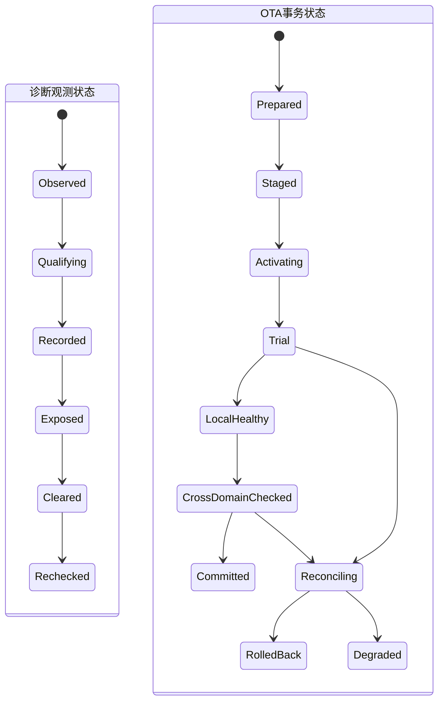

# Week 15 — 周六巩固：诊断—OTA 状态机、证据链与恢复设计

学习日期：2026-10-24，星期六，Asia/Shanghai；Week 15。能力阶段：第二阶段“系统链路与问题分析”。今天只巩固本周已经安排的 Day 45—48，不推进 Day 49、不新增普通专题，也不提前讲后续阶段。建议用时 60 分钟。

执行前已完整分页扫描仓库全部状态的 Issue 与全部评论，并把完整空快照交给答卷扫描脚本；没有答卷 Issue、正文编辑、本人 `[补交]` 评论或附件，本聊天也没有新增真实作答。因此 Day 34—48 继续记为待评审。本课只给独立作答、画图、证据链和恢复决策训练，不附参考答案、示范作答或预设根因，不代写个人反思。

## 1. 巩固范围与资料边界

| 已安排单元 | 今天的训练重点 |
| --- | --- |
| [Day 45：诊断架构 I](https://qiantao18817568425-art.github.io/Architecture_Learning-/lessons/day-45.html) | Monitor、资格化、DTC、Snapshot/Extended Data、持久化与跨复位关联 |
| [Day 46：诊断架构 II](https://qiantao18817568425-art.github.io/Architecture_Learning-/lessons/day-46.html) | tester—DoIP—router/DCM—Dem 服务链，清除与业务修复边界 |
| [Day 47：OTA / 回滚 I](https://qiantao18817568425-art.github.io/Architecture_Learning-/lessons/day-47.html) | 版本合同、A/B 安装状态机、trial boot、提交与失败恢复 |
| [Day 48：OTA / 回滚 II](https://qiantao18817568425-art.github.io/Architecture_Learning-/lessons/day-48.html) | 多域依赖、staging barrier、兼容门禁、安全提交与整车验收 |
| [Week 15 周五复盘](https://qiantao18817568425-art.github.io/Architecture_Learning-/lessons/week-15-friday.html) | 用统一证据账本连接诊断观测链和 OTA 变更链 |

Day 47—48 于 2026-10-23 按用户明确要求补充登记并首次发布；计划日期、发布时间和学习证据保持分开。材料存在不代表已经学习或掌握。

官方资料复核日期：2026-10-24。今天不扩展新专题，只复用本周已经核验的规范边界：

- [AUTOSAR Diagnostic Event Manager R22-11](https://www.autosar.org/fileadmin/standards/R22-11/CP/AUTOSAR_SWS_DiagnosticEventManager.pdf)：事件资格化、DTC 状态、事件内存、Snapshot/Extended Data 与清除边界。
- [AUTOSAR Diagnostic Communication Manager R22-11](https://www.autosar.org/fileadmin/standards/R22-11/CP/AUTOSAR_SWS_DiagnosticCommunicationManager.pdf)：诊断会话、安全、正负响应、P2/P2* 与 Dem/应用职责。
- [AUTOSAR Diagnostic over IP R22-11](https://www.autosar.org/fileadmin/standards/R22-11/CP/AUTOSAR_SWS_DiagnosticOverIP.pdf)：Routing Activation、诊断消息及 DoIP 正负 ACK 的范围。
- [AUTOSAR Adaptive Platform UCM R22-11](https://www.autosar.org/fileadmin/standards/R22-11/AP/AUTOSAR_SWS_UpdateAndConfigurationManagement.pdf) 与 [Vehicle UCM](https://www.autosar.org/standards/adaptive-platform/vehicle-update-and-configuration-management)：软件包处理、激活、回滚和整车协调职责。
- [AOSP OTA updates](https://source.android.com/docs/core/ota)、[A/B system updates](https://source.android.com/docs/core/ota/ab)、[bootloader OTA requirements](https://source.android.com/docs/core/architecture/bootloader/updating) 与 [Android Verified Boot](https://source.android.com/docs/security/features/verifiedboot)：Slot 写入、首启、提交、回退和验证启动边界。

当前仍缺车型、SoC、硬件阶段、Android/Yocto/Hypervisor/MCU/TBox 版本、诊断字典、DoIP 路由、分区或双银行方案、UCM/V-UCM 实现、版本兼容矩阵、车辆状态门禁、rollback index、数据迁移规则、时间锚点和实机日志。下文全部为教学构造，接口、状态、数值和策略都须按当前项目确认。

本次从 `F:/座舱日志分析/交付物/T12T诊断技能家族-优化版/` 重新读取并检查全部 21 项技能入口；深入使用通用三入口、跨域消息、电源/STR、稳定性复位、启动 HMI、虚拟化/TEE、MCU 与 TPM 分责专项。

## 2. 一小时独立训练

| 时间 | 独立任务 | 必交产出 |
| --- | --- | --- |
| 0—8 分钟 | 回答 5 道快问 | 5 条短答；未知项标“待确认” |
| 8—23 分钟 | 白纸重画六条路径与双状态机 | 架构图、状态图及接口观测点 |
| 23—43 分钟 | 分析综合案例 | 双时间线、最早未闭环点、竞争假设 |
| 43—53 分钟 | 建证据与恢复决策 | 证据账本、区分实验、恢复阶梯 |
| 53—60 分钟 | 补验证矩阵与演练包 | 《版本变更故障取证包 V1》与个人反思 |

### 2.1 快问

1. Monitor 报告 ACK、事件 qualified、DTC stored、0x19 读到 DTC 和用户功能恢复分别属于哪一层完成？
2. DoIP 0x8002、UDS 最终正响应、0x14 清除成功和下一 operation cycle 不再复现之间还缺哪些证据？
3. staged ACK、write complete、set-active、trial boot、local healthy、global commit 与整车业务验收为什么不能合并成一个状态？
4. 复位后终态未知时，怎样用 readback、幂等键和总 deadline 决定查询、继续、重试、回滚或人工介入？
5. 为什么“回滚后恢复”只能说明恢复覆盖范围？还需要什么区分实验才能收敛触发、直接失效和根因？

## 3. 画图训练：六条路径与双状态机

请先在白纸上重画六条路径，标出每个跨域接口的输入、权威状态、输出、Owner、时钟、关联 ID 和观测点：

1. 控制流：授权、诊断请求、precheck、stage、activate、commit/rollback。
2. 数据流：DTC/快照、manifest、payload、签名、版本与迁移数据。
3. 状态流：事件/DTC、包、Slot/银行、域版本、健康门禁与 campaign。
4. 电源/生命周期流：power cycle、boot、VM、进程、ECU 与唤醒代际。
5. 安全流：身份/权限、Verified Boot、rollback protection 与不可逆元数据。
6. 证据流：incidentId、requestId、campaignId、transactionId、hash、journal 与 readback。

再补全下面的状态骨架。图只给已学状态名称，不给本题路径答案；请自行补 guard、超时、复位、失败出口和 Owner。

图后回答：

- 哪些状态由本地模块权威保存，哪些必须由整车 Orchestrator 收敛？
- 哪些状态转换需要版本 readback，哪些还需要业务验收？
- 哪些动作可能清除或覆盖诊断证据，执行前怎样冻结证据？
- campaign、boot/VM/domain generation 与 operation cycle 怎样组成同一事件的关联键？
- 哪些安全元数据不可逆，谁有权允许进入该转换？

## 4. 综合案例：回滚显示成功，下次唤醒告警再次出现

以下记录来自教学构造。不同域时钟尚未校准，编号只表示采集顺序；题目不预设根因。

### 4.1 现象

一次整车 campaign 涉及 Yocto/Hypervisor、Android Guest 与 MCU。升级后车辆出现“唤醒后部分车身状态不刷新”，平台执行回滚并显示成功；车辆当次恢复。下一个 power cycle 后，同一用户告警再次出现。当前没有现车拓扑、完整版本矩阵、原始包、录像或授权故障注入结果。

### 4.2 构造记录

| 编号 | 原始记录 | 你必须自行判断的边界 |
| --- | --- | --- |
| E1 | campaign C315 记录目标集 Y12/A18/M9；三域都有 staged ACK，ACK 持久语义未给出 | 接口完成、介质状态与全局 barrier |
| E2 | Android boot generation A81 显示 A18，并产生 local healthy；没有完整 global commit journal | 单域运行、整车提交与证据缺口 |
| E3 | 两次 MCU 版本查询分别返回 M8 与 M9；查询源、缓存、新鲜度和 MCU boot counter 缺失 | readback 权威性与代际关联 |
| E4 | 唤醒后目标 signal topic 停止更新；其他 topic 与 heartbeat 仍增长，没有目标 topic 逐跳 sequence | 故障范围与跨域交接 |
| E5 | Monitor 的 event report 返回 ACK；缺 debounce、operation cycle 和 status transition | 事件报告、资格化与 DTC 状态 |
| E6 | tester Routing Activation 和 DoIP 0x8002 成功；0x19 最终返回一条历史 DTC，但 Snapshot 没有共同时间锚点 | 传输、服务结果与 incident 归属 |
| E7 | 0x14 最终正响应后 HMI 告警消失；清除前证据归档记录缺失 | 清除动作、显示变化与缺陷修复 |
| E8 | Orchestrator 接受 rollback request R52；各域最终版本与安全状态没有同一时刻的完整读回 | 请求 ACK、实际回退与兼容版本集 |
| E9 | 旧 campaign C314 的 healthy callback 在 C315/R52 期间到达；没有接受或拒绝审计 | 迟到消息与当前状态机 |
| E10 | 扩大复位后 signal 恢复；复位前队列、路由、线程和异常包未保存 | 恢复覆盖、证据损失与因果边界 |
| E11 | 下一 power cycle 告警再次出现，0x19 返回同一 DTC 编号；occurrence、first/most-recent-fail 未提供 | 同一编号、同一 incident 与再现 |
| E12 | 候选旧版本可能受 rollback protection 或数据 schema 限制；真实策略和计数器未知 | 安全边界与可回退性 |

### 4.3 双时间线

请分别画：

1. **变更时间线：**C315 precheck→stage→activate→trial→local/cross-domain health→commit/rollback R52→下一 power cycle。
2. **故障时间线：**signal 最后新鲜值→事件报告→DTC 状态→tester 读取/清除→恢复动作→业务验收→复现。

两条时间线必须用下列字段关联：vehicle/build/config、campaignId、transactionId、incidentId、requestId、boot/VM/domain generation、operation cycle、版本与 Slot/银行、monotonic phase、原始时钟与映射锚点。

## 5. 证据链与竞争假设

### 5.1 最早未闭环点

独立写出：

- 两条时间线各自最后一个已证实成功交接；
- 各自下一个预期输出；
- 该输出是明确失败、没有观测、无法关联还是证据互相冲突；
- E10 的“复位后恢复”能覆盖到哪里，不能证明什么；
- 当前初步责任域及暂时不能归责的域。

### 5.2 证据账本

| 证据 | 原始文件/行号 | 域与时钟 | 代际与对象 ID | 原始事实 | 直接/相关/反证/背景/缺失 | 支持或反驳 | 覆盖边界 |
| --- | --- | --- | --- | --- | --- | --- | --- |
| E1…E12 |  |  |  |  |  |  |  |

### 5.3 竞争假设

至少提出四个跨不同接口边界的假设。题目不提供候选根因；每个假设必须可被证伪。

| 假设 | 支持证据 | 反证 | 缺失证据 | 单变量区分实验 | 成立/否定判据 |
| --- | --- | --- | --- | --- | --- |
| H1 |  |  |  |  |  |
| H2 |  |  |  |  |  |
| H3 |  |  |  |  |  |
| H4 |  |  |  |  |  |

## 6. 恢复决策与旧消息处理

为候选动作填表。不得只写“重启”或“全部回滚”。

| 候选动作 | 触发条件 | 前置 readback/证据 | 影响面 | 安全/数据限制 | 证据损失 | 失败出口 | 业务完成判据 |
| --- | --- | --- | --- | --- | --- | --- | --- |
| 重取当前状态/刷新缓存 |  |  |  |  |  |  |  |
| 重建目标订阅或连接 |  |  |  |  |  |  |  |
| 重启直接 Consumer/Provider |  |  |  |  |  |  |  |
| 局部域回滚或重新激活 |  |  |  |  |  |  |  |
| 恢复整车兼容版本集 |  |  |  |  |  |  |  |
| 明确降级并人工介入 |  |  |  |  |  |  |  |

再定义以下规则：

- C314、C315 与 R52 回调的接受条件；
- 重复 stage/activate/clear 命令的幂等键和结果查询；
- 超时后迟到 ACK、healthy、UDS 响应和旧缓存的拒绝与审计；
- 掉电/复位后 authority、journal、当前版本、DTC 状态和总 deadline 的恢复顺序；
- 终态 unknown 时禁止的副作用动作，以及升级恢复半径的条件。

## 7. 可执行验证矩阵

| 用例 | 注入或步骤 | 关键观测点 | 预期结果 | 反例 | 回退/退出 | 状态 |
| --- | --- | --- | --- | --- | --- | --- |
| 正常整车升级 | 完成 stage、分批激活和提交 | campaign、版本集、barrier、health |  |  |  | 待执行 |
| staged 后掉电 | 在不同域 ACK 前后受控掉电 | journal、介质、power/boot |  |  |  | 待执行 |
| 激活中复位 | 在 trial 与门禁阶段复位 | generation、in-flight、readback |  |  |  | 待执行 |
| 旧回调迟到 | 延迟 C314 healthy/ACK | 拒绝原因与审计 |  |  |  | 待执行 |
| DoIP/UDS 重连 | 在诊断读取或清除时断链 | connection、request、P2/P2* |  |  |  | 待执行 |
| 清除后再现 | 清除并跨 operation/power cycle | DTC/status/snapshot/occurrence |  |  |  | 待执行 |
| 版本不兼容 | 让一个域保持旧接口版本 | 双端版本、握手、业务 sequence |  |  |  | 待执行 |
| 安全回退受阻 | 回退目标低于允许下限 | AVB/rollback index/审计 |  |  |  | 待执行 |
| 数据迁移不可逆 | 新 schema 写入后申请回退 | schema、迁移 journal、readback |  |  |  | 待执行 |
| 唤醒回归 | 升级/回滚后连续唤醒 | power/boot、topic、DTC、HMI |  |  |  | 待执行 |
| 连续 20 轮 | 重复升级失败与恢复 | 资源、队列、存储、时限 |  |  |  | 待执行 |

所有破坏性测试只能在项目授权且可恢复的环境执行；未运行的项目保持“待执行”，不得写成通过。

## 8. 可复用产物：《版本变更故障取证包 V1》

提交一个可复用模板，至少包含：

1. 项目身份、真实拓扑、软硬件版本和版本合同；
2. 六条路径与 Android Guest、Yocto Host、Hypervisor、MCU、TBox、外设边界；
3. 诊断与 OTA 双状态机、权威状态和提交屏障；
4. campaign/incident/request、全域 generation、operation cycle 与时间锚点；
5. ACK→服务终态→局部健康→跨域兼容→全局提交→业务验收阶梯；
6. 双时间线、证据账本、竞争假设与最小区分实验；
7. 超时、复位、旧消息、幂等、unknown、readback、回滚/降级规则；
8. 测试矩阵和证据保留策略；
9. TPM 分责：首轮牵头、触发候选、直接修复、接口/恢复策略、安全审核、验证；
10. 未确认项、Owner、下一动作、截止时间和关闭判据。

个人反思由你本人填写：

- 今天哪一个 ACK 最容易被我误当成整车完成？
- 我是否把“同一个 DTC 编号”直接拼成了同一个 incident？
- 我的恢复动作是否大于当前证据证明的故障范围？
- 哪个动作不可逆？执行前我必须拿到哪三项证据？

## 9. 提交说明

本课编号 **week-15-saturday**。请提交：5 道快问、六流架构图、双状态机、双时间线、最早未闭环点、证据账本、四个以上竞争假设、恢复决策表、旧消息规则、验证矩阵、《版本变更故障取证包 V1》和个人反思。

使用页面末尾“上传／提交答卷”，或进入[答卷中心](https://qiantao18817568425-art.github.io/Architecture_Learning-/answers/index.html)。答卷、附件与批改公开，请只提交可公开且已脱敏的学习材料。编辑原答卷或本人以 `[补交]` 开头评论会生成新版本并重新评审。

## 附录：21 项 T12T 技能覆盖检查

| 技能 | 本次判断 |
| --- | --- |
| t12t-cockpit-diagnosis | 适用，深入：定义现象、版本、材料、时间基准、运行域与初步路由 |
| t12t-log-analysis | 适用，深入：双时间线、generation、证据分级、最早未闭环点与竞争假设 |
| t12t-platform-architecture | 适用，深入：六条路径、域边界、权威状态、接口与观测点 |
| t12t-display-black-freeze | 条件适用：升级/唤醒后显示与 HMI 是相邻回归；当前无显示底层证据 |
| t12t-touch-input | 条件适用：跨版本输入回归需要覆盖；当前无触摸原始事件 |
| t12t-avm-camera-stream | 条件适用：整车版本集合需验证 Camera/AVM 设备与帧流兼容 |
| t12t-power-sleep-str | 适用，深入：掉电窗口、power cycle、唤醒代际与恢复验证 |
| t12t-audio-path | 条件适用：共享 DSP/功放/路由属于跨域更新相邻回归 |
| t12t-stability-crash-reset | 适用，深入：复位层级、boot reason、恢复半径和证据连续性 |
| t12t-performance-jank | 条件适用：健康门禁超时需排除资源和调度迟到；当前无性能采样 |
| t12t-ethernet-sgmii | 条件适用：DoIP 承载需分清 link/IP/TCP/诊断层；当前无 PHY/PCS 故障证据 |
| t12t-wireless-phone-link | 条件适用：TBox/远程下载承载与升级后无线回归待项目确认 |
| t12t-cross-domain-msg | 适用，深入：barrier、topic/sequence、deadline、readback 与旧 campaign 隔离 |
| t12t-boot-hmi | 适用，深入：trial boot、ready/health 门禁、版本展示和用户验收 |
| t12t-log-storm | 条件适用：升级/复位期日志量、轮转和首错覆盖需要容量证据 |
| t12t-usb-typec-storage | 条件适用：离线包、外置介质和存储完整性待项目确认 |
| t12t-virtualization-tee | 适用，深入：Guest/Host 版本、VM generation、Verified Boot 与安全元数据 |
| t12t-db-ke-forensics | 条件适用：若 trial boot 崩溃需保全 DB/KE/tombstone/pstore；当前无异常包 |
| t12t-mcu | 适用，深入：MCU 双银行/版本、供电、激活、boot counter 与诊断 readback |
| t12t-tpm-triage | 适用，深入：区分首轮牵头、触发候选、直接修复、接口策略、安全与验证责任 |
| t12t-tpm-5y8d | 暂不展开：没有确认根因、发生/逃逸原因和修复验证，不强行形成 5Y/8D |

关键证据缺口：现车车型/SoC/硬件阶段和拓扑、域与升级部署、诊断字典和配置、DoIP/UDS 路由与时限、A/B/双银行实现、版本兼容矩阵、UCM/V-UCM/私有编排、车辆状态策略、安全启动和 rollback index、数据迁移、全域时钟锚点、campaign journal、权威版本 readback、真实日志/异常包、故障注入授权与回归结果。